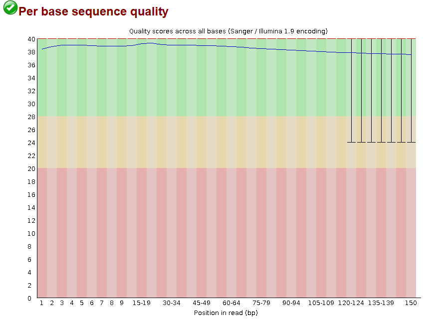

# Metagenomic Bioinformatics Workflow

This repository contains the metagenomic bioinformatics workflow used in the study “How to avoid competitive exclusion: a possible role of gut microbiota in niche differentiation between coexisting species” Delleuze et al., 2026 in revision.  

This workflow was developed with reproducibility and accessibility in mind. Detailed explanations, commands, and annotations are provided throughout the pipeline to facilitate its use by researchers with limited experience in bioinformatics, particularly those learning metagenomic data analysis.

As a self-learning researcher during the development of this project, I aimed to document each step as clearly as possible so that others facing similar challenges can more easily understand and reproduce the analyses.

This workflow is based on Sergio Guajardo-Leiva’s [**workshop**](https://github.com/phageattack/Workshop) and has been adapted for multiple samples, enabling functional annotation of contigs.

The dataset used contains samples of intestinal tissue from *Abatus agassizii* (n=5), *Schizocosmus abatoïdes* (n=5) (formerly *Tripylus abatoïdes*) and marine sediment (n=3).


**Figure 1: Bioinformatic workflow for metagenomic data processing.** Bioinformatics steps are contained in blue boxes, while specific software and parameters are indicated in green boxes. Co-assembly, gene prediction, and functional annotation were performed independently for each sample group: *A. agassizii* gut microbiota (n = 5), *S. abatoïdes* gut microbiota (n = 5), and sediment samples (n = 3).

**Acknowledgements**

All analyses were performed using computational resources provided by the National Laboratory for High Performance Computing ([NLHPC](https://www.nlhpc.cl/)), Chile (CCSS210001). Their infrastructure and support were essential for the completion of this work.

**Notes**: 

1. Throughout this workflow, *Abatus* refers to *Abatus agassizii*, and *Tripylus* refers to *Schizocosmus abatoïdes* (formerly *Tripylus abatoïdes*).
2. In the document, scripts are highlighted in blue, while explanatory annotations are shown in orange. 
3. Several tools (e.g., Simka, Samtools, MetaBAT2) were installed in Conda environments. Before submitting jobs with `sbatch script.sh`, the corresponding Conda environment must be activated. If using software modules available through NLHPC, the required modules should be loaded before running the commands.
4. ChatGPT (OpenAI) was used to assist in code optimization and script refinement. All analyses, parameter choices, and workflow validation were performed by the author.

Credits: Mélanie Delleuze De Prada 

**Table of contents**

# **Pre-processing of the readings**

## **0. Data preparation**

- **Transfer files to the cluster**
    
    We use *scp* to transfer all the raw files from the raw reads of our samples.
    
    ```bash
    # For all samples
    scp -P port_number /input_directory/*.fq.gz /output_directory
    # Extract files
    gunzip /output_directory/*.fq.gz
    ```
    

## 1. Quality control with FastQC

- **Quality control with FastQC**
    
    The first step is to assess the quality of our raw data; we do this using [FastQC](https://www.bioinformatics.babraham.ac.uk/projects/fastqc/).
    
    First, we create a directory for the FastQC results.
    
    ```bash
    mkdir /1.fastqc
    ```
    
    We create a SLURM script file to run FastQC:
    
    ```bash
    #!/bin/bash
    #---------------Script SBATCH - NLHPC ----------------
    #SBATCH -J Fastqc_all #task name
    #SBATCH -p general #partitin to use
    #SBATCH -n 1 #number of cores
    #SBATCH -c 10 #number of cores/CPU
    #SBATCH --mem-per-cpu=4090 #memory por CPU
    #SBATCH -t 1-02:35:00 #maximum task execution time in SLURM
    #SBATCH --mail-user= #your user mail
    #SBATCH --mail-type=ALL
    #SBATCH -o Fastqc_all_%j.err.out
    #SBATCH -e Fastqc_all_%j.err.out
    #-----------------Toolchain---------------------------
    ml purge #clean modules
    ml intel/2022.00
    # ----------------Modulos----------------------------
    ml FastQC/0.11.9-Java-11 Perl/5.34.0 #load the necessary modules
    # ----------------Comando--------------------------
    export OMP_PLACES=cores
    fastqc -o /1.fastqc -t 10 /0.data/*.fq
    ```
    
    Parameters used:
    
    ```bash
    -t number of threads to use 
    -o output directory 
    input/path input directory
    ```
    
    To run the script we use :
    
    ```bash
    sbatch fastqc.script.sh
    ```
    
    We download with *scp* the FastQC results to our local computer so that we can view them.
    
    ```bash
    scp port_number /1.fastqc/*.html "/directory/local/computer/"
    ```
    
    For each file (forward and reverse), an HTML file is generated containing the results and a quality analysis.
    
    
    
    Figure 2: FastQC output for AB_GT16_1, showing good sequence quality. 
    

## **2. Filtering and Trimming with Cutadapt**

- **Filter the reads using Cutadapt**
    
    We use [Cutadapt](https://cutadapt.readthedocs.io/en/stable/guide.html) to perform high-quality filtering and trimming of the raw reads, based on the results from fastQC.
    
    We created a script to run Cutadapt on all the samples:
    
    *Note: this script could have been optimised using a for loop: *file .fq in directory… do cutadapt function.*
    
    ```bash
    #!/bin/bash
    #---------------Script SBATCH - NLHPC ----------------
    #SBATCH -J Cutadapt_all
    #SBATCH -p main
    #SBATCH -n 1
    #SBATCH -c 12
    #SBATCH --mem-per-cpu=2839
    #SBATCH --mail-type=ALL
    #SBATCH -o Cutadapt_all_%j.err.out
    #SBATCH -e Cutadapt_all_%j.err.out
    #-----------------Toolchain---------------------------
    ml purge
    ml aocc/4.2.0
    # ----------------Modulos----------------------------
    ml py-cutadapt/4.7-zen4-j
    # ----------------Comando--------------------------
    export OMP_PLACES=cores
    
    #the commands for each forward and reverse sample (this could be better implemented using a for loop)
    cutadapt -j 12 -q 30,30 -Q 30,30 -m 50 -u 3 --max-n 0 -o /home/mdelleuze/metaG/2.trimed/Ab_GT16_1_trimed1.fq -p /home/mdelleuze/metaG/2.trimed/Ab_GT16_2_trimed2.fq /home/mdelleuze/metaG/0.data/Ab_GT16_1.fq /home/mdelleuze/metaG/0.data/Ab_GT16_2.fq
    cutadapt -j 12 -q 30,30 -Q 30,30 -m 50 -u 3 --max-n 0 -o /home/mdelleuze/metaG/2.trimed/Ab_GT17_1_trimed1.fq -p /home/mdelleuze/metaG/2.trimed/Ab_GT17_2_trimed2.fq /home/mdelleuze/metaG/0.data/Ab_GT17_1.fq /home/mdelleuze/metaG/0.data/Ab_GT17_2.fq
    cutadapt -j 12 -q 30,30 -Q 30,30 -m 50 -u 3 --max-n 0 -o /home/mdelleuze/metaG/2.trimed/Ab_GT19_1_trimed1.fq -p /home/mdelleuze/metaG/2.trimed/Ab_GT19_2_trimed2.fq /home/mdelleuze/metaG/0.data/Ab_GT19_1.fq /home/mdelleuze/metaG/0.data/Ab_GT19_2.fq
    cutadapt -j 12 -q 30,30 -Q 30,30 -m 50 -u 3 --max-n 0 -o /home/mdelleuze/metaG/2.trimed/Ab_GT20_1_trimed1.fq -p /home/mdelleuze/metaG/2.trimed/Ab_GT20_2_trimed2.fq /home/mdelleuze/metaG/0.data/Ab_GT20_1.fq /home/mdelleuze/metaG/0.data/Ab_GT20_2.fq
    cutadapt -j 12 -q 30,30 -Q 30,30 -m 50 -u 3 --max-n 0 -o /home/mdelleuze/metaG/2.trimed/Ab_GT22_1_trimed1.fq -p /home/mdelleuze/metaG/2.trimed/Ab_GT22_2_trimed2.fq /home/mdelleuze/metaG/0.data/Ab_GT22_1.fq /home/mdelleuze/metaG/0.data/Ab_GT22_2.fq
    cutadapt -j 12 -q 30,30 -Q 30,30 -m 50 -u 3 --max-n 0 -o /home/mdelleuze/metaG/2.trimed/sed10_1_trimed1.fq -p /home/mdelleuze/metaG/2.trimed/sed10_2_trimed2.fq /home/mdelleuze/metaG/0.data/sed10_1.fq /home/mdelleuze/metaG/0.data/sed10_2.fq
    cutadapt -j 12 -q 30,30 -Q 30,30 -m 50 -u 3 --max-n 0 -o /home/mdelleuze/metaG/2.trimed/sed6_1_trimed1.fq -p /home/mdelleuze/metaG/2.trimed/sed6_2_trimed2.fq /home/mdelleuze/metaG/0.data/sed6_1.fq /home/mdelleuze/metaG/0.data/sed6_2.fq
    cutadapt -j 12 -q 30,30 -Q 30,30 -m 50 -u 3 --max-n 0 -o /home/mdelleuze/metaG/2.trimed/sed7_1_trimed1.fq -p /home/mdelleuze/metaG/2.trimed/sed7_2_trimed2.fq /home/mdelleuze/metaG/0.data/sed7_1.fq /home/mdelleuze/metaG/0.data/sed7_2.fq
    cutadapt -j 12 -q 30,30 -Q 30,30 -m 50 -u 3 --max-n 0 -o /home/mdelleuze/metaG/2.trimed/Tr_GT11_1_trimed1.fq -p /home/mdelleuze/metaG/2.trimed/Tr_GT11_2_trimed2.fq /home/mdelleuze/metaG/0.data/Tr_GT11_1.fq /home/mdelleuze/metaG/0.data/Tr_GT11_2.fq
    cutadapt -j 12 -q 30,30 -Q 30,30 -m 50 -u 3 --max-n 0 -o /home/mdelleuze/metaG/2.trimed/Tr_GT4_1_trimed1.fq -p /home/mdelleuze/metaG/2.trimed/Tr_GT4_2_trimed2.fq /home/mdelleuze/metaG/0.data/Tr_GT4_1.fq /home/mdelleuze/metaG/0.data/Tr_GT4_2.fq
    cutadapt -j 12 -q 30,30 -Q 30,30 -m 50 -u 3 --max-n 0 -o /home/mdelleuze/metaG/2.trimed/Tr_GT6_1_trimed1.fq -p /home/mdelleuze/metaG/2.trimed/Tr_GT6_2_trimed2.fq /home/mdelleuze/metaG/0.data/Tr_GT6_1.fq /home/mdelleuze/metaG/0.data/Tr_GT6_2.fq
    cutadapt -j 12 -q 30,30 -Q 30,30 -m 50 -u 3 --max-n 0  -o /home/mdelleuze/metaG/2.trimed/Tr_GT7_1_trimed1.fq -p /home/mdelleuze/metaG/2.trimed/Tr_GT7_2_trimed2.fq /home/mdelleuze/metaG/0.data/Tr_GT7_1.fq /home/mdelleuze/metaG/0.data/Tr_GT7_2.fq
    cutadapt -j 12 -q 30,30 -Q 30,30 -m 50 -u 3 --max-n 0 -o /home/mdelleuze/metaG/2.trimed/Tr_GT9_1_trimed1.fq -p /home/mdelleuze/metaG/2.trimed/Tr_GT9_2_trimed2.fq /home/mdelleuze/metaG/0.data/Tr_GT9_1.fq /home/mdelleuze/metaG/0.data/Tr_GT9_2.fq 
    
    ```
    
    Parameters used:
    
    ```bash
    -j 12: Uses 12 cores to speed up the process
    -q 30,30: Trims low-quality bases from the end of the reads (q30)
    -Q 30,30: Applies the same quality filter at the start
    -m 50: Discards reads shorter than 50 bp after trimming
    -u 3: Removes the first 3 nucleotides from each read (this was determined based on FastQC results)
    --max-n 0: Does not allow ambiguous bases (N)
    -o/-p: Forward and reverse output files
    ```
    
    We run the command:
    
    ```bash
    sbatch cutadapt.script.sh
    ```
    
    We can check the quality after trimming using FastQC again, by adapting the previous code to the new forward and reverse files processed by cutadapt.
    
    Cutadapt results extracted from the log files:
    
    | **Sample** | **Total read pairs processed** | **Pairs too short** | **% Pairs too short** | **Pairs with N** | **% Pairs with N** | **Pairs passing filters** | **% Pairs passing filters** | **Total basepairs processed** | **Read 1 (bp)** | **Read 2 (bp)** | **Quality-trimmed (bp)** | **% Quality trimmed** | **Trimmed Read 1 (bp)** | **Trimmed Read 2 (bp)** | **Total written (bp)** | **% Total written** | **Written Read 1 (bp)** | **Written Read 2 (bp)** |
    | --- | --- | --- | --- | --- | --- | --- | --- | --- | --- | --- | --- | --- | --- | --- | --- | --- | --- | --- |
    | **Ab_GT16** | 52,627,604 | 3,447,836 | 6.6% | 949,246 | 1.8% | 48,230,522 | 91.6% | 15,788,281,200 | 7,894,140,600 | 7,894,140,600 | 553,547,075 | 3.5% | 211,867,080 | 341,679,995 | 13,790,224,737 | 87.3% | 6,857,847,268 | 6,932,377,469 |
    | **Ab_GT17** | 53,860,369 | 3,464,799 | 6.4% | 923,026 | 1.7% | 49,472,544 | 91.9% | 16,158,110,700 | 8,079,055,350 | 8,079,055,350 | 556,815,826 | 3.4% | 213,140,892 | 343,674,934 | 14,152,514,041 | 87.6% | 7,037,551,523 | 7,114,962,518 |
    | **Ab_GT19** | 56,663,468 | 3,504,235 | 6.2% | 815,145 | 1.4% | 52,344,088 | 92.4% | 16,999,040,400 | 8,499,520,200 | 8,499,520,200 | 554,154,158 | 3.3% | 216,470,581 | 337,683,577 | 14,990,026,153 | 88.2% | 7,450,453,560 | 7,539,572,593 |
    | **Ab_GT20** | 57,047,237 | 3,531,611 | 6.2% | 803,027 | 1.4% | 52,712,599 | 92.4% | 17,114,171,100 | 8,557,085,550 | 8,557,085,550 | 543,017,905 | 3.2% | 206,209,865 | 336,808,040 | 15,110,985,682 | 88.3% | 7,512,201,879 | 7,598,783,803 |
    | **Ab_GT22** | 59,417,564 | 4,234,953 | 7.1% | 719,204 | 1.2% | 54,463,407 | 91.7% | 17,825,269,200 | 8,912,634,600 | 8,912,634,600 | 643,194,755 | 3.6% | 242,357,075 | 400,837,680 | 15,575,536,767 | 87.4% | 7,741,389,557 | 7,834,147,210 |
    | **Sed10** | 72,258,561 | 2,144,697 | 3.0% | 1,513,171 | 2.1% | 68,600,693 | 94.9% | 21,677,568,300 | 10,838,784,150 | 10,838,784,150 | 321,541,264 | 1.5% | 112,413,679 | 209,127,585 | 20,034,989,415 | 92.4% | 9,932,338,799 | 10,102,650,616 |
    | **Sed6** | 58,714,101 | 1,518,361 | 2.6% | 708,426 | 1.2% | 56,487,314 | 96.2% | 17,614,230,300 | 8,807,115,150 | 8,807,115,150 | 185,987,466 | 1.1% | 55,090,619 | 130,896,847 | 16,548,070,369 | 93.9% | 8,199,283,993 | 8,348,786,376 |
    | **Sed7** | 58,705,048 | 1,410,078 | 2.4% | 947,474 | 1.6% | 56,347,496 | 96.0% | 17,611,514,400 | 8,805,757,200 | 8,805,757,200 | 179,052,231 | 1.0% | 56,757,477 | 122,294,754 | 16,524,994,389 | 93.8% | 8,185,734,502 | 8,339,259,887 |
    | **Tr_GT11** | 69,020,261 | 5,051,545 | 7.3% | 1,372,990 | 2.0% | 62,595,726 | 90.7% | 20,706,078,300 | 10,353,039,150 | 10,353,039,150 | 1,154,935,192 | 5.6% | 483,413,874 | 671,521,318 | 17,599,854,120 | 85.0% | 8,762,703,233 | 8,837,150,887 |
    | **Tr_GT4** | 53,745,430 | 3,929,940 | 7.3% | 1,068,486 | 2.0% | 48,747,004 | 90.7% | 16,123,629,000 | 8,061,814,500 | 8,061,814,500 | 886,011,643 | 5.5% | 364,169,961 | 521,841,682 | 13,713,178,715 | 85.1% | 6,831,580,828 | 6,881,597,887 |
    | **Tr_GT6** | 56,619,465 | 3,937,897 | 7.0% | 997,198 | 1.8% | 51,684,370 | 91.3% | 16,985,839,500 | 8,492,919,750 | 8,492,919,750 | 862,903,543 | 5.1% | 353,381,540 | 509,522,003 | 14,582,823,308 | 85.9% | 7,260,363,171 | 7,322,460,137 |
    | **Tr_GT7** | 54,690,900 | 3,839,827 | 7.0% | 902,392 | 1.6% | 49,948,681 | 91.3% | 16,407,270,000 | 8,203,635,000 | 8,203,635,000 | 862,196,906 | 5.3% | 359,022,568 | 503,174,338 | 14,074,480,046 | 85.8% | 7,006,074,271 | 7,068,405,775 |
    | **Tr_GT9** | 59,039,445 | 4,233,095 | 7.2% | 1,167,597 | 2.0% | 53,638,753 | 90.9% | 17,711,833,500 | 8,855,916,750 | 8,855,916,750 | 888,425,285 | 5.0% | 356,264,992 | 532,160,293 | 15,169,817,434 | 85.6% | 7,552,962,911 | 7,616,854,523 |
- **Quantifying before and after**
    
    We can count the number of sequences before and after the cut to keep track. Using the following Bash script.
    
    ```bash
    #!/bin/bash
    #---------------Script SBATCH - NLHPC ----------------
    #SBATCH -J Calcul_bases_secuencias
    #SBATCH -p main
    #SBATCH -n 1
    #SBATCH -c 2
    #SBATCH --mem-per-cpu=2839
    #SBATCH --mail-user=melanie.delleuze@gmail.com
    #SBATCH --mail-type=ALL
    #SBATCH -o Calcul_bases_secuencias_%j.err.out
    #SBATCH -e Calcul_bases_secuencias_%j.err.out
    
    #-----------------Toolchain---------------------------
    ml purge
    ml aocc/4.2.0
    # ----------------Modulos----------------------------
    # ----------------Comando--------------------------
    export OMP_PLACES=cores
    # Specify the folders containing the original and cropped files
    carpeta_original="/home/mdelleuze/metaG/0.data"
    carpeta_recortado="/home/mdelleuze/metaG/2.trimed"
    # Output file
    archivo_salida="resultados_secuencias_bases.tsv"
    # Write the table header
    echo -e "Archivo\Secuencias_antes\tSecuencias_despues\tBases_antes\tBases_despues" > $archivo_salida
    # Process each file in the original folder
    for archivo in "$carpeta_original"/*.fq; do
        # Get the base filename (without the folder and extension)
        nombre_base=$(basename "$archivo" .fq)
    
        # Determine the file extension of the cropped files based on the original
        if [[ "$nombre_base" =~ _1$ ]]; then
            sufijo_trimed="_trimed1"
        elif [[ "$nombre_base" =~ _2$ ]]; then
            sufijo_trimed="_trimed2"
        else
            echo "Archivo no reconocido: $nombre_base. Saltando..."
            continue
        fi
    
        # Specify the paths of the original and cropped files
        archivo_original="$carpeta_original/$nombre_base.fq"
        archivo_recortado="$carpeta_recortado/${nombre_base}${sufijo_trimed}.fq"
    
        # Check that both files exist
        if [[ ! -f "$archivo_original" ]]; then
            echo "Archivo original no encontrado: $archivo_original. Saltando..."
            continue
        fi
    
        if [[ ! -f "$archivo_recortado" ]]; then
            echo "Archivo recortado no encontrado: $archivo_recortado. Saltando..."
            continue
        fi
    
        # Count the number of sequences before and after the cut
        secuencias_antes=$(grep -c "^@" "$archivo_original")
        secuencias_despues=$(grep -c "^@" "$archivo_recortado")
    
        # Count the number of total bases before and after the cut
        bases_antes=$(grep -A 1 "^@" "$archivo_original" | grep -v "^@" | grep -v "^+" | tr -d '\n' | wc -c)
        bases_despues=$(grep -A 1 "^@" "$archivo_recortado" | grep -v "^@" | grep -v "^+" | tr -d '\n' | wc -c)
    
        # Escribe los resultados en el archivo de salida
        echo -e "$nombre_base\t$secuencias_antes\t$secuencias_despues\t$bases_antes\t$bases_despues" >> $archivo_salida
    done
    
    echo "Análisis completado. Resultados guardados en $archivo_salida"
    
    ```
    
    Parámetros: 
    
    ```bash
    grep -c: Counts the number of lines that match a pattern.
    ‘^@’: Searches for lines beginning with the @ character. In a FASTQ file, lines beginning with @ are the sequence headers (i.e., read identifiers).
    wc -l: Counts the total number of lines in the file.
    awk “{print $1/4}”:
    •    awk: Processes the output of the previous command.
    •    $1/4: Divides the total number of lines by 4. This is done because in a FASTQ file each read is represented by 4 lines:
    1.    Header line (starts with @).
    2.    Nucleotide sequence.
    3.    Separator line (starts with +).
    4.    Base qualities.
    ```
    
    Results: 
    
    | **File** | **Sequences_before** | **Sequences_after** | **Difference_sequences** | **Bases_before** | **Bases_after** | **Bases_difference** |
    | --- | --- | --- | --- | --- | --- | --- |
    | **Ab_GT16_1** | 52,627,604 | 48,230,522 | 4,397,082 | 7,999,395,806 | 6,954,308,310 | 1,045,087,496 |
    | **Ab_GT16_2** | 52,627,604 | 48,230,522 | 4,397,082 | 7,999,395,806 | 7,028,838,511 | 970,557,295 |
    | **Ab_GT17_1** | 53,860,369 | 49,472,544 | 4,387,825 | 8,186,776,086 | 7,136,496,609 | 1,050,279,477 |
    | **Ab_GT17_2** | 53,860,369 | 49,472,544 | 4,387,825 | 8,186,776,086 | 7,213,907,604 | 972,868,482 |
    | **Ab_GT19_1** | 56,663,468 | 52,344,088 | 4,319,380 | 8,612,847,134 | 7,555,141,734 | 1,057,705,400 |
    | **Ab_GT19_2** | 56,663,468 | 52,344,088 | 4,319,380 | 8,612,847,134 | 7,644,260,767 | 968,586,367 |
    | **Ab_GT20_1** | 57,047,237 | 52,712,599 | 4,334,638 | 8,671,180,022 | 7,617,627,075 | 1,053,552,947 |
    | **Ab_GT20_2** | 57,047,237 | 52,712,599 | 4,334,638 | 8,671,180,022 | 7,704,208,999 | 966,971,023 |
    | **Ab_GT22_1** | 59,417,564 | 54,463,407 | 4,954,157 | 9,031,469,726 | 7,850,316,369 | 1,181,153,357 |
    | **Ab_GT22_2** | 59,417,564 | 54,463,407 | 4,954,157 | 9,031,469,726 | 7,943,074,022 | 1,088,395,704 |
    | **sed10_1** | 72,258,561 | 68,600,693 | 3,657,868 | 10,983,301,270 | 10,069,540,183 | 913,761,087 |
    | **sed10_2** | 72,258,561 | 68,600,693 | 3,657,868 | 10,983,301,270 | 10,239,852,000 | 743,449,270 |
    | **sed6_1** | 58,714,101 | 56,487,314 | 2,226,787 | 8,924,543,350 | 8,312,258,619 | 612,284,731 |
    | **sed6_2** | 58,714,101 | 56,487,314 | 2,226,787 | 8,924,543,350 | 8,461,761,002 | 462,782,348 |
    | **sed7_1** | 58,705,048 | 56,347,496 | 2,357,552 | 8,923,167,294 | 8,298,429,492 | 624,737,802 |
    | **sed7_2** | 58,705,048 | 56,347,496 | 2,357,552 | 8,923,167,294 | 8,451,954,877 | 471,212,417 |
    | **Tr_GT11_1** | 69,020,261 | 62,595,726 | 6,424,535 | 10,491,079,670 | 8,887,894,683 | 1,603,184,987 |
    | **Tr_GT11_2** | 69,020,261 | 62,595,726 | 6,424,535 | 10,491,079,670 | 8,962,342,337 | 1,528,737,333 |
    | **Tr_GT4_1** | 53,745,430 | 48,747,004 | 4,998,426 | 8,169,305,358 | 6,929,074,834 | 1,240,230,524 |
    | **Tr_GT4_2** | 53,745,430 | 48,747,004 | 4,998,426 | 8,169,305,358 | 6,979,091,893 | 1,190,213,465 |
    | **Tr_GT6_1** | 56,619,465 | 51,684,370 | 4,935,095 | 8,606,158,678 | 7,363,731,909 | 1,242,426,769 |
    | **Tr_GT6_2** | 56,619,465 | 51,684,370 | 4,935,095 | 8,606,158,678 | 7,425,828,875 | 1,180,329,803 |
    | **Tr_GT7_1** | 54,690,900 | 49,948,681 | 4,742,219 | 8,313,016,798 | 7,105,971,631 | 1,207,045,167 |
    | **Tr_GT7_2** | 54,690,900 | 49,948,681 | 4,742,219 | 8,313,016,798 | 7,168,303,135 | 1,144,713,663 |
    | **Tr_GT9_1** | 59,039,445 | 53,638,753 | 5,400,692 | 8,973,995,638 | 7,660,240,415 | 1,313,755,223 |
    | **Tr_GT9_2** | 59,039,445 | 53,638,753 | 5,400,692 | 8,973,995,638 | 7,724,132,027 | 1,249,863,611 |

## **3. Filter reads from Echinoidea and Eukaryota**

- **Download reference data and perform mapping with Bowtie2**
    
    In order to remove the host reads, the ideal approach is to use the reference genome for the species and extract the reads that map to that genome. However, in our case, there is no reference genome for *A. agassizii* or *S. abatoïdes*. Therefore, the reference genome of the closest species is used; in this case, we used the [reference genome](https://www.ncbi.nlm.nih.gov/bioproject/?term=PRJEB83474) of *Echinocardium cordatum*, an irregular sea urchin of the same order as *Abatus* and *Schizocosmus*.
    
    We also used the *Abatus cavernosus* contigs from a preliminary assembly carried out by Carolina Márquez (unpublished data).
    
    We convert fq files to fastas.
    
    ```bash
    #!/bin/bash
    #---------------Script SBATCH - NLHPC ----------------
    #SBATCH -J fq2fasta
    #SBATCH -p general
    #SBATCH -n 1
    #SBATCH -c 1
    #SBATCH --mem-per-cpu=100
    #SBATCH --mail-type=ALL
    #SBATCH -o fq2fasta_%j.err.out
    #SBATCH -e fq2fasta_%j.err.out
    
    #-----------------Toolchain---------------------------
    ml purge
    ml intel/2022.00
    
    # ----------------Módulos----------------------------
    ml intel-compilers/2022.0.1  impi/2021.5.0 seqtk/1.3 
    
    # Folder with fq files
    cd /home/mdelleuze/metaG/2.trimed || exit
    #Carpeta para los outputs
    /home/mdelleuze/metaG/2.blast_a_cavernosus
    
    # Browse all fq
    for fq in *.fq; do
        # Convertir a fasta
        seqtk seq -a "$fq" > "/home/mdelleuze/metaG/2.blast_a_cavernosus/${fq%.fq}.fasta"
        echo "Convertido $fq -> /home/mdelleuze/metaG/2.blast_a_cavernosus/${fq%.fq}.fasta"
    done
    
    echo "¡Conversión completa!"
    ```
    
    Now we download the genome of [*Echinocardium cordatum*](https://www.ncbi.nlm.nih.gov/datasets/genome/?taxon=39298) from NCBI (1 [scaffold](https://www.ncbi.nlm.nih.gov/datasets/genome/GCA_965644095.1/) y 1 [chromosome](https://www.ncbi.nlm.nih.gov/datasets/genome/GCA_965644145.1/)). We activate our conda environment (my_envi), which contains *datasets*.
    
    ```bash
    conda activate my_envi
    datasets download genome accession GCA_965644145.1 --include gff3,rna,cds,protein,genome,seq-report
    datasets download genome accession GCA_965644095.1 --include gff3,rna,cds,protein,genome,seq-report
    ```
    
    Once downloaded, we need to join the two files together. 
    
    ```bash
    cat GCA_965644095/ncbi_dataset/data/GCA_965644095.1/GCA_965644095.1_eeEchCord2.hap2.1_genomic.fna \
        GCA_965644145/ncbi_dataset/data/GCA_965644145.1/GCA_965644145.1_eeEchCord2.hap1.1_genomic.fna \
        > E_cordatum_genome.fna
    ```
    
    And now we’re adding the *Abatus cavernosus* contigs to create a more comprehensive FASTA file. First, we rename the headers of the *A. cavernosus* sequences and concatenate them again.
    
    ```bash
    #Rename
    sed 's/^>/>Acav_/' /home/mdelleuze/metaG/0.contigs_Abatus_cavernosus/LG5_wen_asm.minia.contigs.fa \
    > LG5_wen_asm.minia.contigs_renamed.fa
    
    #Concatenate
    cat E_cordatum_genome.fna LG5_wen_asm.minia.contigs_renamed.fa > combined_Ecordatum_Acavernosus.fna
    ```
    
    We can now proceed with the mapping using [Bowtie2](https://bowtie-bio.sourceforge.net/bowtie2/manual.shtml#the-bowtie2-aligner).
    
    ```bash
    #!/bin/bash
    #---------------Script SBATCH - NLHPC ----------------
    #SBATCH -J bowtie2_Ecordatum_Acavernosus
    #SBATCH -p general
    #SBATCH -n 1
    #SBATCH -c 10
    #SBATCH --mem-per-cpu=6000
    #SBATCH --mail-type=ALL
    #SBATCH -o bowtie2_Ecordatum_Acavernosus_%j.err.out
    #SBATCH -e bowtie2_Ecordatum_Acavernosus_%j.err.out
    
    #-----------------Toolchain---------------------------
    ml purge
    ml intel/2022.00
    #-----------------Modules------------------------------
    ml Bowtie2/2.4.5
    
    # ----------------Variables----------------------------
    DATA_DIR="/home/mdelleuze/metaG/2.trimed"
    REF="/home/mdelleuze/metaG/0.genomes/E.cordatum/combined_Ecordatum_Acavernosus.fna"
    INDEX="/home/mdelleuze/metaG/0.genomes/E.cordatum/Ecordatum_Acavernosus_index"
    output_dir="/home/mdelleuze/metaG/2.blast_Ecordatum_Acavernosus_bowtie"
    
    # Index construction
    if [ ! -f "${INDEX}.1.bt2" ]; then
        echo "Construyendo índice de Bowtie2..."
        bowtie2-build "$REF" "$INDEX"
    fi
    
    # Create output folders
    MAPPED_DIR="${output_dir}/mapped_reads"
    UNMAPPED_DIR="${output_dir}/unmapped_reads"
    mkdir -p "$MAPPED_DIR" "$UNMAPPED_DIR"
    
    # Loop in each fastq
    for fq1 in ${DATA_DIR}/*_1_trimed1.fq; do
        sample=$(basename "$fq1" _1_trimed1.fq)
        fq2="${DATA_DIR}/${sample}_2_trimed2.fq"
    
        echo "Procesando muestra: $sample ..."
    
        bowtie2 -x "$INDEX" -1 "$fq1" -2 "$fq2" -p 10 --verbose --end-to-end --very-sensitive \
            --al-conc "${MAPPED_DIR}/${sample}_mapped.fq" \
            --un-conc "${UNMAPPED_DIR}/${sample}_unmapped.fq" \
            -S /dev/null
    done
    
    echo "Proceso finalizado. Reads mapeados en $MAPPED_DIR, no mapeados en $UNMAPPED_DIR"
    ```
    
    Parameters:
    
    ```bash
    bowtie2-build: build the Bowtie index
        $REF    Reference FASTA file (genome or contigs).
        $INDEX    Base name for the index to be generated.
    
    bowtie2: map the reads to the reference
    -x ‘$INDEX’    Bowtie2 index (generated with bowtie2-build).
    -1 ‘$fq1’    FASTQ file with forward reads (R1).
    -2 ‘$fq2’    FASTQ file with reverse reads (R2).
    -p 10    Use 10 cores/threads.
    --verbose    Display detailed information about the process.
    --end-to-end    Full end-to-end alignment (no trimming).
    --very-sensitive    High sensitivity → detects more alignments, slower.
    --al-conc <file>    Saves mapped read pairs (produces .1 and .2).
    --un-conc <file>    Saves unmapped read pairs (produces .1 and .2).
    -S /dev/null    Does not generate a SAM file (output is discarded).
    ```
    
    This places the reads that mapped to the reference in a “mapped” folder and those that did not map in an “unmapped” folder.
    
    **Results:**
    
    | **Sample** | **Total_sequences** | **Total _sequences_mapped_to_contigs** | **Percentage_mapped** | **Total_sequences_unmapped_to_contigs** | **Percentage_unmapped** |
    | --- | --- | --- | --- | --- | --- |
    | **Ab_GT16_1** | 48,230,522 | 21,024,320 | 43.59 | 27,206,202 | 56.41 |
    | **Ab_GT16_2** | 48,230,522 | 21,024,320 | 43.59 | 27,206,202 | 56.41 |
    | **Ab_GT17_1** | 49,472,544 | 21,366,320 | 43.19 | 28,106,224 | 56.81 |
    | **Ab_GT17_2** | 49,472,544 | 21,366,320 | 43.19 | 28,106,224 | 56.81 |
    | **Ab_GT19_1** | 52,344,088 | 23,953,324 | 45.76 | 28,390,764 | 54.24 |
    | **Ab_GT19_2** | 52,344,088 | 23,953,324 | 45.76 | 28,390,764 | 54.24 |
    | **Ab_GT20_1** | 52,712,599 | 23,411,969 | 44.41 | 29,300,630 | 55.59 |
    | **Ab_GT20_2** | 52,712,599 | 23,411,969 | 44.41 | 29,300,630 | 55.59 |
    | **Ab_GT22_1** | 54,463,407 | 24,592,480 | 45.15 | 29,870,927 | 54.85 |
    | **Ab_GT22_2** | 54,463,407 | 24,592,480 | 45.15 | 29,870,927 | 54.85 |
    | **sed10_1** | 68,600,693 | 189,101 | 0.28 | 68,411,592 | 99.72 |
    | **sed10_2** | 68,600,693 | 189,101 | 0.28 | 68,411,592 | 99.72 |
    | **sed6_1** | 56,487,314 | 38,716 | 0.07 | 56,448,598 | 99.93 |
    | **sed6_2** | 56,487,314 | 38,716 | 0.07 | 56,448,598 | 99.93 |
    | **sed7_1** | 56,347,496 | 21,633 | 0.04 | 56,325,863 | 99.96 |
    | **sed7_2** | 56,347,496 | 21,633 | 0.04 | 56,325,863 | 99.96 |
    | **Tr_GT11_1** | 62,595,726 | 25,073,391 | 40.06 | 37,522,335 | 59.94 |
    | **Tr_GT11_2** | 62,595,726 | 25,073,391 | 40.06 | 37,522,335 | 59.94 |
    | **Tr_GT4_1** | 48,747,004 | 20,054,574 | 41.14 | 28,692,430 | 58.86 |
    | **Tr_GT4_2** | 48,747,004 | 20,054,574 | 41.14 | 28,692,430 | 58.86 |
    | **Tr_GT6_1** | 51,684,370 | 21,686,707 | 41.96 | 29,997,663 | 58.04 |
    | **Tr_GT6_2** | 51,684,370 | 21,686,707 | 41.96 | 29,997,663 | 58.04 |
    | **Tr_GT7_1** | 49,948,681 | 20,976,625 | 42.00 | 28,972,056 | 58.00 |
    | **Tr_GT7_2** | 49,948,681 | 20,976,625 | 42.00 | 28,972,056 | 58.00 |
    | **Tr_GT9_1** | 53,638,753 | 19,867,119 | 37.04 | 33,771,634 | 62.96 |
    | **Tr_GT9_2** | 53,638,753 | 19,867,119 | 37.04 | 33,771,634 | 62.96 |
    
- **Co-assemble unmapped reads with Megahit**
    
    We will use [megahit](https://github.com/voutcn/megahit) for co-assembly
    
    We use the reads that did not map to the *E. cordatum* genome and the *A. cavernosus* contigs, and perform group-based co-assembly (*Abatus*, *Tripylus*, Sediment)
    
    ```bash
    #!/bin/bash
    #---------------Script SBATCH - NLHPC ----------------
    #SBATCH -J megahit_coassemblies_removed_Ecor_Acav
    #SBATCH -p general
    #SBATCH -n 1
    #SBATCH -c 20
    #SBATCH --mem-per-cpu=3000
    #SBATCH --mail-type=ALL
    #SBATCH -o megahit_coassemblies_removed_Ecor_Acav_%j.err.out
    #SBATCH -e megahit_coassemblies_removed_Ecor_Acav_%j.err.out
    #-----------------Toolchain---------------------------
    ml purge
    ml intel/2022.00
    # ----------------Modulos----------------------------
    ml GCCcore/11.2.0 MEGAHIT/1.2.9
    # ----------------Comando--------------------------
    export OMP_PLACES=cores
    
    # Co-assembly *Abatus* samples
    megahit -m 10e9 -t 20 --min-contig-len 1000 \
    -1 /home/mdelleuze/metaG/2.blast_Ecordatum_Acavernosus_bowtie/unmapped_reads/Ab_GT16_unmapped.1.fq,/home/mdelleuze/metaG/2.blast_Ecordatum_Acavernosus_bowtie/unmapped_reads/Ab_GT17_unmapped.1.fq,/home/mdelleuze/metaG/2.blast_Ecordatum_Acavernosus_bowtie/unmapped_reads/Ab_GT19_unmapped.1.fq,/home/mdelleuze/metaG/2.blast_Ecordatum_Acavernosus_bowtie/unmapped_reads/Ab_GT20_unmapped.1.fq,/home/mdelleuze/metaG/2.blast_Ecordatum_Acavernosus_bowtie/unmapped_reads/Ab_GT22_unmapped.1.fq \
    -2 /home/mdelleuze/metaG/2.blast_Ecordatum_Acavernosus_bowtie/unmapped_reads/Ab_GT16_unmapped.2.fq,/home/mdelleuze/metaG/2.blast_Ecordatum_Acavernosus_bowtie/unmapped_reads/Ab_GT17_unmapped.2.fq,/home/mdelleuze/metaG/2.blast_Ecordatum_Acavernosus_bowtie/unmapped_reads/Ab_GT19_unmapped.2.fq,/home/mdelleuze/metaG/2.blast_Ecordatum_Acavernosus_bowtie/unmapped_reads/Ab_GT20_unmapped.2.fq,/home/mdelleuze/metaG/2.blast_Ecordatum_Acavernosus_bowtie/unmapped_reads/Ab_GT22_unmapped.2.fq \
    -o /home/mdelleuze/metaG/2.blast_Ecordatum_Acavernosus_bowtie/3.coassembly/Abatus_coassembly
    
    # Co-assembly sediment **samples
    megahit -m 10e9 -t 20 --min-contig-len 1000 \
    -1 /home/mdelleuze/metaG/2.blast_Ecordatum_Acavernosus_bowtie/unmapped_reads/sed6_unmapped.1.fq,/home/mdelleuze/metaG/2.blast_Ecordatum_Acavernosus_bowtie/unmapped_reads/sed7_unmapped.1.fq,/home/mdelleuze/metaG/2.blast_Ecordatum_Acavernosus_bowtie/unmapped_reads/sed10_unmapped.1.fq \
    -2 /home/mdelleuze/metaG/2.blast_Ecordatum_Acavernosus_bowtie/unmapped_reads/sed6_unmapped.2.fq,/home/mdelleuze/metaG/2.blast_Ecordatum_Acavernosus_bowtie/unmapped_reads/sed7_unmapped.2.fq,/home/mdelleuze/metaG/2.blast_Ecordatum_Acavernosus_bowtie/unmapped_reads/sed10_unmapped.2.fq \
    -o /home/mdelleuze/metaG/2.blast_Ecordatum_Acavernosus_bowtie/3.coassembly/Sediment_coassembly
    
    # Co-assembly *Tripylus* samples 
    megahit -m 10e9 -t 20 --min-contig-len 1000 \
    -1 /home/mdelleuze/metaG/2.blast_Ecordatum_Acavernosus_bowtie/unmapped_reads/Tr_GT4_unmapped.1.fq,/home/mdelleuze/metaG/2.blast_Ecordatum_Acavernosus_bowtie/unmapped_reads/Tr_GT6_unmapped.1.fq,/home/mdelleuze/metaG/2.blast_Ecordatum_Acavernosus_bowtie/unmapped_reads/Tr_GT7_unmapped.1.fq,/home/mdelleuze/metaG/2.blast_Ecordatum_Acavernosus_bowtie/unmapped_reads/Tr_GT9_unmapped.1.fq,/home/mdelleuze/metaG/2.blast_Ecordatum_Acavernosus_bowtie/unmapped_reads/Tr_GT11_unmapped.1.fq \
    -2 /home/mdelleuze/metaG/2.blast_Ecordatum_Acavernosus_bowtie/unmapped_reads/Tr_GT4_unmapped.2.fq,/home/mdelleuze/metaG/2.blast_Ecordatum_Acavernosus_bowtie/unmapped_reads/Tr_GT6_unmapped.2.fq,/home/mdelleuze/metaG/2.blast_Ecordatum_Acavernosus_bowtie/unmapped_reads/Tr_GT7_unmapped.2.fq,/home/mdelleuze/metaG/2.blast_Ecordatum_Acavernosus_bowtie/unmapped_reads/Tr_GT9_unmapped.2.fq,/home/mdelleuze/metaG/2.blast_Ecordatum_Acavernosus_bowtie/unmapped_reads/Tr_GT11_unmapped.2.fq \
    -o /home/mdelleuze/metaG/2.blast_Ecordatum_Acavernosus_bowtie/3.coassembly/Tripylus_coassembly
    ```
    
    Parameters :
    
    ```bash
    -m 10e9: Maximum memory (10 GB)
    -t 20: 20 threads
    --min-contig-len 1000: Minimum contig length (1000 bp)
    -1: Forward files (comma-separated)
    -2: Reverse files (same order as forward)
    -o: Output directory
    ```
    
    **Results:**
    
    | **Coassembly** | **n_contigs** | **total_bp** | **min_length** | **max_bp** | **average_bp** | **N50** |
    | --- | --- | --- | --- | --- | --- | --- |
    | **Final_Contigs_Abatus** | 325,903 | 532,844,217 | 1,000 | 31,256 | 1,634 | 1,636 |
    | **Final_Contigs_Sediment** | 621,237 | 1,609,104,906 | 1,000 | 332,236 | 2,590 | 3,104 |
    | **Final_Contigs_Tripylus** | 343,897 | 568,405,086 | 1,000 | 22,703 | 1,652 | 1,656 |
- **Use Whokaryote to classify contigs**
    
    [Whokaryote](https://github.com/LottePronk/whokaryote) classifies contigs as prokaryotic or eukaryotic based on characteristics such as gene density, gene length, and the presence of eukaryotic signatures ([Pronk y Medema, 2022](https://www.microbiologyresearch.org/content/journal/mgen/10.1099/mgen.0.000823)).
    
    The first step is to install whokaryote in a new conda environment.
    
    ```bash
    conda create -c bioconda -n whokaryote whokaryote
    conda activate whokaryote
    ```
    
    Now we can run Whokaryote in our conda environment
    
    ```bash
    #!/bin/bash
    #---------------Script SBATCH - NLHPC ----------------
    #SBATCH -J whokaryote_contigs
    #SBATCH -p general
    #SBATCH -n 1
    #SBATCH -c 6
    #SBATCH --mem-per-cpu=1000
    #SBATCH --mail-type=ALL
    #SBATCH -o whokaryote_contigs_%j.err.out
    #SBATCH -e whokaryote_contigs_%j.err.out
    
    #-----------------Toolchain---------------------------
    ml purge
    
    cd /home/mdelleuze/metaG/2.blast_Ecordatum_Acavernosus_bowtie/3.coassembly/
    
    whokaryote.py \
      --contigs /home/mdelleuze/metaG/2.blast_Ecordatum_Acavernosus_bowtie/3.coassembly/all_final_contigs.fa \
      --outdir /home/mdelleuze/metaG/2.blast_Ecordatum_Acavernosus_bowtie/3.coassembly/3.whokaryote_filtering \
      --model S \
      --f \
      --minsize 1000
    ```
    
    Parámetros:
    
    ```bash
    --contigs	 Specify your FASTA file containing the contigs (here, the FASTA file is a concatenation of all the contigs)
    --outdir	output directory
    --model S	Use Whokaryote's “standalone” model    S or T	
    --f	Create separate FASTA by organisms type	
    --minsize 1000	minimum contig size of 1000 bp
    ```
    
    **Results**:
    
    | **Fasta** | **Total_sequences** | **Eukaryotes** | **Prokaryotes** | **Unclassified** |
    | --- | --- | --- | --- | --- |
    | **Final_Contigs_Abatus_Tripylus_Sediment** | 1,291,037 | 378,169 | 298,912 | 613,956 |
    
    About 30% of the contigs are eukaryotic.
    
    Now we need to map the reads to those contigs, just as we did in the first filtering step.
    
- **Map reads to eukaryotic contigs using Bowtie and retrieve double-filtered reads**
    
    Now we can map the unmapped reads from the beginning to the eukaryotic contigs and retrieve the unmapped reads again. It is the same script used for the first mapping with Bowtie, adapted to the new reference (eukaryotic contigs).
    
    ```bash
    #!/bin/bash
    #---------------Script SBATCH - NLHPC ----------------
    #SBATCH -J bowtie2_eucaryote
    #SBATCH -p general
    #SBATCH -n 1
    #SBATCH -c 10
    #SBATCH --mem-per-cpu=600
    #SBATCH --mail-type=ALL
    #SBATCH -o bowtie2_eucaryote_%j.err.out
    #SBATCH -e bowtie2_eucaryote_%j.err.out
    
    #-----------------Toolchain---------------------------
    ml purge
    ml intel/2022.00
    #-----------------Modules------------------------------
    ml Bowtie2/2.4.5
    
    # ----------------Variables----------------------------
    DATA_DIR="/home/mdelleuze/metaG/2.blast_Ecordatum_Acavernosus_bowtie/unmapped_reads"
    REF="/home/mdelleuze/metaG/2.blast_Ecordatum_Acavernosus_bowtie/3.coassembly/3.whokaryote_filtering/eukaryotes.fasta"
    INDEX="/home/mdelleuze/metaG/2.blast_Ecordatum_Acavernosus_bowtie/3.coassembly/3.whokaryote_filtering/eukaryotes_index"
    output_dir="/home/mdelleuze/metaG/2.blast_Ecordatum_Acavernosus_bowtie/3.coassembly/3.whokaryote_filtering/filtering_reads"
    
    # Build index (first time only)
    if [ ! -f "${INDEX}.1.bt2" ]; then
        echo "Construyendo índice de Bowtie2..."
        bowtie2-build "$REF" "$INDEX"
    fi
    
    # Create outputs folders
    MAPPED_DIR="${output_dir}/mapped_reads"
    UNMAPPED_DIR="${output_dir}/unmapped_reads"
    mkdir -p "$MAPPED_DIR" "$UNMAPPED_DIR"
    
    # Loop for all fastq
    for fq1 in ${DATA_DIR}/*_unmapped.1.fq; do
        sample=$(basename "$fq1" _unmapped.1.fq)
        fq2="${DATA_DIR}/${sample}_unmapped.2.fq"
    
        echo "Procesando muestra: $sample ..."
    
        bowtie2 -x "$INDEX" -1 "$fq1" -2 "$fq2" -p 10 --verbose --end-to-end --very-sensitive \
            --al-conc "${MAPPED_DIR}/${sample}_mapped.fq" \
            --un-conc "${UNMAPPED_DIR}/${sample}_unmapped.fq" \
            -S /dev/null
    done
    
    echo "Proceso finalizado. Reads mapeados en $MAPPED_DIR, no mapeados en $UNMAPPED_DIR"
    ```
    
    **Results:**
    
    | **Sample** | **Total sequences incial (raw)** | **Total sequences unmapped first filter *E. cordatum* and *A. cavernosus*** | **Total sequenes mapped whokaryote** | **Percentage** | **Total sequences unmapped whokaryote** | **Percentage** |
    | --- | --- | --- | --- | --- | --- | --- |
    | **Ab_GT16_1** | 48,230,522 | 27,206,202 | 10,478,935 | 38.52 | 16,727,267 | 61.48 |
    | **Ab_GT16_2** | 48,230,522 | 27,206,202 | 10,478,935 | 38.52 | 16,727,267 | 61.48 |
    | **Ab_GT17_1** | 49,472,544 | 28,106,224 | 10,844,416 | 38.58 | 17,261,808 | 61.42 |
    | **Ab_GT17_2** | 49,472,544 | 28,106,224 | 10,844,416 | 38.58 | 17,261,808 | 61.42 |
    | **Ab_GT19_1** | 52,344,088 | 28,390,764 | 10,909,443 | 38.43 | 17,481,321 | 61.57 |
    | **Ab_GT19_2** | 52,344,088 | 28,390,764 | 10,909,443 | 38.43 | 17,481,321 | 61.57 |
    | **Ab_GT20_1** | 52,712,599 | 29,300,630 | 11,371,527 | 38.81 | 17,929,103 | 61.19 |
    | **Ab_GT20_2** | 52,712,599 | 29,300,630 | 11,371,527 | 38.81 | 17,929,103 | 61.19 |
    | **Ab_GT22_1** | 54,463,407 | 29,870,927 | 11,484,205 | 38.45 | 18,386,722 | 61.55 |
    | **Ab_GT22_2** | 54,463,407 | 29,870,927 | 11,484,205 | 38.45 | 18,386,722 | 61.55 |
    | **sed10_1** | 68,600,693 | 68,411,592 | 10,863,280 | 15.88 | 57,548,312 | 84.12 |
    | **sed10_2** | 68,600,693 | 68,411,592 | 10,863,280 | 15.88 | 57,548,312 | 84.12 |
    | **sed6_1** | 56,487,314 | 56,448,598 | 7,238,608 | 12.82 | 49,209,990 | 87.18 |
    | **sed6_2** | 56,487,314 | 56,448,598 | 7,238,608 | 12.82 | 49,209,990 | 87.18 |
    | **sed7_1** | 56,347,496 | 56,325,863 | 7,540,423 | 13.39 | 48,785,440 | 86.61 |
    | **sed7_2** | 56,347,496 | 56,325,863 | 7,540,423 | 13.39 | 48,785,440 | 86.61 |
    | **Tr_GT11_1** | 62,595,726 | 37,522,335 | 16,840,741 | 44.88 | 20,681,594 | 55.12 |
    | **Tr_GT11_2** | 62,595,726 | 37,522,335 | 16,840,741 | 44.88 | 20,681,594 | 55.12 |
    | **Tr_GT4_1** | 48,747,004 | 28,692,430 | 12,834,031 | 44.73 | 15,858,399 | 55.27 |
    | **Tr_GT4_2** | 48,747,004 | 28,692,430 | 12,834,031 | 44.73 | 15,858,399 | 55.27 |
    | **Tr_GT6_1** | 51,684,370 | 29,997,663 | 13,243,236 | 44.15 | 16,754,427 | 55.85 |
    | **Tr_GT6_2** | 51,684,370 | 29,997,663 | 13,243,236 | 44.15 | 16,754,427 | 55.85 |
    | **Tr_GT7_1** | 49,948,681 | 28,972,056 | 13,024,605 | 44.96 | 15,947,451 | 55.04 |
    | **Tr_GT7_2** | 49,948,681 | 28,972,056 | 13,024,605 | 44.96 | 15,947,451 | 55.04 |
    | **Tr_GT9_1** | 53,638,753 | 33,771,634 | 14,373,311 | 42.56 | 19,398,323 | 57.44 |
    | **Tr_GT9_2** | 53,638,753 | 33,771,634 | 14,373,311 | 42.56 | 19,398,323 | 57.44 |

## **4. Simka - k-mer composition of reads**

- **Use Simka to compare metagenomes based on their k-mer content**
    
    [Simka](https://github.com/GATB/simka) uses k-mer composition to calculate distances between metagenomes. First, we install Simka in a new Conda environment.
    
    ```bash
    conda create -n simka_env -c bioconda -c conda-forge simka
    conda activate simka_env
    ```
    
    Now we'll create a file that links each sample to each file, and since it's pair-ended, we need to include both files.
    
    We created this in a text file in the NLHPC session using vim : reads_list.txt
    
    ```bash
    Ab_GT16: /home/mdelleuze/metaG/2.blast_Ecordatum_Acavernosus_bowtie/3.coassembly/3.whokaryote_filtering/filtering_reads/unmapped_reads/Ab_GT16_unmapped.1.fq ; /home/mdelleuze/metaG/2.blast_Ecordatum_Acavernosus_bowtie/3.coassembly/3.whokaryote_filtering/filtering_reads/unmapped_reads/Ab_GT16_unmapped.2.fq
    Ab_GT17: /home/mdelleuze/metaG/2.blast_Ecordatum_Acavernosus_bowtie/3.coassembly/3.whokaryote_filtering/filtering_reads/unmapped_reads/Ab_GT17_unmapped.1.fq ; /home/mdelleuze/metaG/2.blast_Ecordatum_Acavernosus_bowtie/3.coassembly/3.whokaryote_filtering/filtering_reads/unmapped_reads/Ab_GT17_unmapped.2.fq
    Ab_GT19: /home/mdelleuze/metaG/2.blast_Ecordatum_Acavernosus_bowtie/3.coassembly/3.whokaryote_filtering/filtering_reads/unmapped_reads/Ab_GT19_unmapped.1.fq ; /home/mdelleuze/metaG/2.blast_Ecordatum_Acavernosus_bowtie/3.coassembly/3.whokaryote_filtering/filtering_reads/unmapped_reads/Ab_GT19_unmapped.2.fq
    Ab_GT20: /home/mdelleuze/metaG/2.blast_Ecordatum_Acavernosus_bowtie/3.coassembly/3.whokaryote_filtering/filtering_reads/unmapped_reads/Ab_GT20_unmapped.1.fq ; /home/mdelleuze/metaG/2.blast_Ecordatum_Acavernosus_bowtie/3.coassembly/3.whokaryote_filtering/filtering_reads/unmapped_reads/Ab_GT20_unmapped.2.fq
    Ab_GT22: /home/mdelleuze/metaG/2.blast_Ecordatum_Acavernosus_bowtie/3.coassembly/3.whokaryote_filtering/filtering_reads/unmapped_reads/Ab_GT22_unmapped.1.fq ; /home/mdelleuze/metaG/2.blast_Ecordatum_Acavernosus_bowtie/3.coassembly/3.whokaryote_filtering/filtering_reads/unmapped_reads/Ab_GT22_unmapped.2.fq
    Tr_GT4: /home/mdelleuze/metaG/2.blast_Ecordatum_Acavernosus_bowtie/3.coassembly/3.whokaryote_filtering/filtering_reads/unmapped_reads/Tr_GT4_unmapped.1.fq ; /home/mdelleuze/metaG/2.blast_Ecordatum_Acavernosus_bowtie/3.coassembly/3.whokaryote_filtering/filtering_reads/unmapped_reads/Tr_GT4_unmapped.2.fq
    Tr_GT6: /home/mdelleuze/metaG/2.blast_Ecordatum_Acavernosus_bowtie/3.coassembly/3.whokaryote_filtering/filtering_reads/unmapped_reads/Tr_GT6_unmapped.1.fq ; /home/mdelleuze/metaG/2.blast_Ecordatum_Acavernosus_bowtie/3.coassembly/3.whokaryote_filtering/filtering_reads/unmapped_reads/Tr_GT6_unmapped.2.fq
    Tr_GT7: /home/mdelleuze/metaG/2.blast_Ecordatum_Acavernosus_bowtie/3.coassembly/3.whokaryote_filtering/filtering_reads/unmapped_reads/Tr_GT7_unmapped.1.fq ; /home/mdelleuze/metaG/2.blast_Ecordatum_Acavernosus_bowtie/3.coassembly/3.whokaryote_filtering/filtering_reads/unmapped_reads/Tr_GT7_unmapped.2.fq
    Tr_GT9: /home/mdelleuze/metaG/2.blast_Ecordatum_Acavernosus_bowtie/3.coassembly/3.whokaryote_filtering/filtering_reads/unmapped_reads/Tr_GT9_unmapped.1.fq ; /home/mdelleuze/metaG/2.blast_Ecordatum_Acavernosus_bowtie/3.coassembly/3.whokaryote_filtering/filtering_reads/unmapped_reads/Tr_GT9_unmapped.2.fq
    Tr_GT11: /home/mdelleuze/metaG/2.blast_Ecordatum_Acavernosus_bowtie/3.coassembly/3.whokaryote_filtering/filtering_reads/unmapped_reads/Tr_GT11_unmapped.1.fq ; /home/mdelleuze/metaG/2.blast_Ecordatum_Acavernosus_bowtie/3.coassembly/3.whokaryote_filtering/filtering_reads/unmapped_reads/Tr_GT11_unmapped.2.fq
    sed6: /home/mdelleuze/metaG/2.blast_Ecordatum_Acavernosus_bowtie/3.coassembly/3.whokaryote_filtering/filtering_reads/unmapped_reads/sed6_unmapped.1.fq ; /home/mdelleuze/metaG/2.blast_Ecordatum_Acavernosus_bowtie/3.coassembly/3.whokaryote_filtering/filtering_reads/unmapped_reads/sed6_unmapped.2.fq
    sed7: /home/mdelleuze/metaG/2.blast_Ecordatum_Acavernosus_bowtie/3.coassembly/3.whokaryote_filtering/filtering_reads/unmapped_reads/sed7_unmapped.1.fq ; /home/mdelleuze/metaG/2.blast_Ecordatum_Acavernosus_bowtie/3.coassembly/3.whokaryote_filtering/filtering_reads/unmapped_reads/sed7_unmapped.2.fq
    sed10: /home/mdelleuze/metaG/2.blast_Ecordatum_Acavernosus_bowtie/3.coassembly/3.whokaryote_filtering/filtering_reads/unmapped_reads/sed10_unmapped.1.fq ; /home/mdelleuze/metaG/2.blast_Ecordatum_Acavernosus_bowtie/3.coassembly/3.whokaryote_filtering/filtering_reads/unmapped_reads/sed10_unmapped.2.fq
    ```
    
    Now we run the script using Bash
    
    ```bash
    #!/bin/bash
    #--------------- Script SBATCH - NLHPC ----------------
    #SBATCH -J simka_reads
    #SBATCH -p general
    #SBATCH -n 1
    #SBATCH -c 16
    #SBATCH --mem-per-cpu=4000
    #SBATCH -t 5-24:00:00
    #SBATCH --mail-type=ALL
    #SBATCH -o simka_reads_%j.err.out
    #SBATCH -e simka_reads_%j.err.out
    
    #----------------- Modules ---------------------------
    ml purge
    ml intel/2022.00
    
    cd /home/mdelleuze/metaG/2.blast_Ecordatum_Acavernosus_bowtie/3.coassembly/3.whokaryote_filtering/filtering_reads/unmapped_reads/simka_results
    
    simka \
    -in /home/mdelleuze/metaG/2.blast_Ecordatum_Acavernosus_bowtie/3.coassembly/3.whokaryote_filtering/filtering_reads/unmapped_reads/simka_results/reads_list.txt \
    -out /home/mdelleuze/metaG/2.blast_Ecordatum_Acavernosus_bowtie/3.coassembly/3.whokaryote_filtering/filtering_reads/unmapped_reads/simka_results \
    -out-tmp /home/mdelleuze/metaG/2.blast_Ecordatum_Acavernosus_bowtie/3.coassembly/3.whokaryote_filtering/filtering_reads/unmapped_reads/simka_results/simka_tmp \
    -kmer-size 21 \
    -nb-cores 16
    ```
    
    Parameters :
    
    ```bash
    -in : input file containing the list of datasets (reads)
    -out : outputs directory
    -out-tmp : temporary files directory
    -kmer-size 21 :  k-mer size; 21 is the standard value for short reads 
    -nb-cores 16 : number of CPUs to use
    ```
    
    Once the process is complete, the output consists of .csv files containing the distance matrices. We download them and open them in R for multivariate analysis and visualization. 
    
    ```bash
    scp -P port_number directory/*.gz "output\Simka"
    ```
    

# **Gene-centered analisis**

## **5. Co-assembly with Megahit**

- **Co-assemble the double-filtered reads using Megahit**
    
    We can now use the reads that have been filtered twice (against the E. cordatum genome and A. cavernosus contigs, and against the eukaryotic contigs identified by Whokaryote).
    
    We use  [Megahit](https://github.com/voutcn/megahit) for the co-assembly
    
    ```bash
    #!/bin/bash
    #---------------Script SBATCH - NLHPC ----------------
    #SBATCH -J megahit_coassemblies_removed_Ecor_Acav_Euk
    #SBATCH -p general
    #SBATCH -n 1
    #SBATCH -c 20
    #SBATCH --mem-per-cpu=3000
    #SBATCH --mail-type=ALL
    #SBATCH -o megahit_coassemblies_removed_Ecor_Acav_Euk_%j.err.out
    #SBATCH -e megahit_coassemblies_removed_Ecor_Acav_Euk_%j.err.out
    #-----------------Toolchain---------------------------
    ml purge
    ml intel/2022.00
    # ----------------Modulos----------------------------
    ml GCCcore/11.2.0 MEGAHIT/1.2.9
    # ----------------Comando--------------------------
    export OMP_PLACES=cores
    
    # Co-assembly *Abatus* samples
    megahit -m 10e9 -t 20 --min-contig-len 1000 \
    -1 /home/mdelleuze/metaG/2.blast_Ecordatum_Acavernosus_bowtie/3.coassembly/3.whokaryote_filtering/filtering_reads/unmapped_reads/Ab_GT16_unmapped.1.fq,/home/mdelleuze/metaG/2.blast_Ecordatum_Acavernosus_bowtie/3.coassembly/3.whokaryote_filtering/filtering_reads/unmapped_reads/Ab_GT17_unmapped.1.fq,/home/mdelleuze/metaG/2.blast_Ecordatum_Acavernosus_bowtie/3.coassembly/3.whokaryote_filtering/filtering_reads/unmapped_reads/Ab_GT19_unmapped.1.fq,/home/mdelleuze/metaG/2.blast_Ecordatum_Acavernosus_bowtie/3.coassembly/3.whokaryote_filtering/filtering_reads/unmapped_reads/Ab_GT20_unmapped.1.fq,/home/mdelleuze/metaG/2.blast_Ecordatum_Acavernosus_bowtie/3.coassembly/3.whokaryote_filtering/filtering_reads/unmapped_reads/Ab_GT22_unmapped.1.fq \
    -2 /home/mdelleuze/metaG/2.blast_Ecordatum_Acavernosus_bowtie/3.coassembly/3.whokaryote_filtering/filtering_reads/unmapped_reads/Ab_GT16_unmapped.2.fq,/home/mdelleuze/metaG/2.blast_Ecordatum_Acavernosus_bowtie/3.coassembly/3.whokaryote_filtering/filtering_reads/unmapped_reads/Ab_GT17_unmapped.2.fq,/home/mdelleuze/metaG/2.blast_Ecordatum_Acavernosus_bowtie/3.coassembly/3.whokaryote_filtering/filtering_reads/unmapped_reads/Ab_GT19_unmapped.2.fq,/home/mdelleuze/metaG/2.blast_Ecordatum_Acavernosus_bowtie/3.coassembly/3.whokaryote_filtering/filtering_reads/unmapped_reads/Ab_GT20_unmapped.2.fq,/home/mdelleuze/metaG/2.blast_Ecordatum_Acavernosus_bowtie/3.coassembly/3.whokaryote_filtering/filtering_reads/unmapped_reads/Ab_GT22_unmapped.2.fq \
    -o /home/mdelleuze/metaG/2.blast_Ecordatum_Acavernosus_bowtie/3.coassembly/3.whokaryote_filtering/4.new_coassembly/Abatus_coassembly
    
    # Co-assembly sediment **samples
    megahit -m 10e9 -t 20 --min-contig-len 1000 \
    -1 /home/mdelleuze/metaG/2.blast_Ecordatum_Acavernosus_bowtie/3.coassembly/3.whokaryote_filtering/filtering_reads/unmapped_reads/sed6_unmapped.1.fq,/home/mdelleuze/metaG/2.blast_Ecordatum_Acavernosus_bowtie/3.coassembly/3.whokaryote_filtering/filtering_reads/unmapped_reads/sed7_unmapped.1.fq,/home/mdelleuze/metaG/2.blast_Ecordatum_Acavernosus_bowtie/3.coassembly/3.whokaryote_filtering/filtering_reads/unmapped_reads/sed10_unmapped.1.fq \
    -2 /home/mdelleuze/metaG/2.blast_Ecordatum_Acavernosus_bowtie/3.coassembly/3.whokaryote_filtering/filtering_reads/unmapped_reads/sed6_unmapped.2.fq,/home/mdelleuze/metaG/2.blast_Ecordatum_Acavernosus_bowtie/3.coassembly/3.whokaryote_filtering/filtering_reads/unmapped_reads/sed7_unmapped.2.fq,/home/mdelleuze/metaG/2.blast_Ecordatum_Acavernosus_bowtie/3.coassembly/3.whokaryote_filtering/filtering_reads/unmapped_reads/sed10_unmapped.2.fq \
    -o /home/mdelleuze/metaG/2.blast_Ecordatum_Acavernosus_bowtie/3.coassembly/3.whokaryote_filtering/4.new_coassembly/Sediment_coassembly
    
    # Co-assembly *Tripylus* samples 
    megahit -m 10e9 -t 20 --min-contig-len 1000 \
    -1 /home/mdelleuze/metaG/2.blast_Ecordatum_Acavernosus_bowtie/3.coassembly/3.whokaryote_filtering/filtering_reads/unmapped_reads/Tr_GT4_unmapped.1.fq,/home/mdelleuze/metaG/2.blast_Ecordatum_Acavernosus_bowtie/3.coassembly/3.whokaryote_filtering/filtering_reads/unmapped_reads/Tr_GT6_unmapped.1.fq,/home/mdelleuze/metaG/2.blast_Ecordatum_Acavernosus_bowtie/3.coassembly/3.whokaryote_filtering/filtering_reads/unmapped_reads/Tr_GT7_unmapped.1.fq,/home/mdelleuze/metaG/2.blast_Ecordatum_Acavernosus_bowtie/3.coassembly/3.whokaryote_filtering/filtering_reads/unmapped_reads/Tr_GT9_unmapped.1.fq,/home/mdelleuze/metaG/2.blast_Ecordatum_Acavernosus_bowtie/3.coassembly/3.whokaryote_filtering/filtering_reads/unmapped_reads/Tr_GT11_unmapped.1.fq \
    -2 /home/mdelleuze/metaG/2.blast_Ecordatum_Acavernosus_bowtie/3.coassembly/3.whokaryote_filtering/filtering_reads/unmapped_reads/Tr_GT4_unmapped.2.fq,/home/mdelleuze/metaG/2.blast_Ecordatum_Acavernosus_bowtie/3.coassembly/3.whokaryote_filtering/filtering_reads/unmapped_reads/Tr_GT6_unmapped.2.fq,/home/mdelleuze/metaG/2.blast_Ecordatum_Acavernosus_bowtie/3.coassembly/3.whokaryote_filtering/filtering_reads/unmapped_reads/Tr_GT7_unmapped.2.fq,/home/mdelleuze/metaG/2.blast_Ecordatum_Acavernosus_bowtie/3.coassembly/3.whokaryote_filtering/filtering_reads/unmapped_reads/Tr_GT9_unmapped.2.fq,/home/mdelleuze/metaG/2.blast_Ecordatum_Acavernosus_bowtie/3.coassembly/3.whokaryote_filtering/filtering_reads/unmapped_reads/Tr_GT11_unmapped.2.fq \
    -o /home/mdelleuze/metaG/2.blast_Ecordatum_Acavernosus_bowtie/3.coassembly/3.whokaryote_filtering/4.new_coassembly/Tripylus_coassembly
    ```
    
    Parameters: 
    
    ```bash
    -m 10e9: Maximum memory (10 GB)
    -t 20: 20 threads
    --min-contig-len 1000: Minimum contig length (1000 bp)
    -1: Forward files (comma-separated)
    -2: Reverse files (same order as forward)
    -o: Output directory
    ```
    
    **Results:**
    
    | **Coassembly** | **n_contigs** | **total_bp** | **min_length** | **max_bp** | **average_bp** | **N50** |
    | --- | --- | --- | --- | --- | --- | --- |
    | **Final_Contigs_Abatus** | 215,430 | 313,442,762 | 1,000 | 13,122 | 1,454 | 1,426 |
    | **Final_Contigs_Sediment** | 467,506 | 1,235,986,434 | 1,000 | 332,236 | 2,643 | 3,304 |
    | **Final_Contigs_Tripylus** | 229,024 | 336,383,645 | 1,000 | 19,962 | 1,468 | 1,441 |

## **6. Functional annotation of ORFs using a homemade database**

- **Download the relevant databases and create a homemade database**
    
    First, we obtain a gene database in Fasta format. We download it to our computer and use scp to copy it to the cluster, or download it directly into our cluster session. The [Greening Lab](https://bridges.monash.edu/articles/online_resource/Compiled_Greening_lab_metabolic_marker_gene_databases/14431208?backTo=%2Fcollections%2F_%2F5230745&file=27599390) database by  [Lappan et al., 2023](https://www-nature-com.ezproxy.ulb.ac.be/articles/s41564-023-01322-0), contains one FASTA file per major metabolic pathway; we concatenated all the FASTA files into a single file.  I used a concatenated database containing Greening Lab [SCyc](https://auth.ulb.be/login?service=https%3a%2f%2flogin.ezproxy.ulb.ac.be%2flogin%3fqurl%3dezp.2aHR0cHM6Ly9vbmxpbmVsaWJyYXJ5LndpbGV5LmNvbS9kb2kvMTAuMTExMS8xNzU1LTA5OTguMTMzMDY-), [NCyc](https://academic.oup.com/bioinformatics/article/35/6/1040/5085377), and [MCyc](https://onlinelibrary-wiley-com.ezproxy.ulb.ac.be/doi/full/10.1111/1755-0998.13589).
    
    ```bash
    #Downloading a database from GitHub: an example
    git clone https://github.com/repository
    
    #Sometimes FASTA files come in split ZIP files, so to convert them back to FASTA we need p7zip
    #Load the modules:
    ml GCCcore/11.2.0 p7zip/17.04
    #Extract the FASTA file using:
    7z x BaseDeDatos.zip
    
    ```
    
    The SCyc, NCyc and MCyc fasta files contain homologous gene sequences to avoid false positives caused by a small database (see the associated papers). As we are going to concatenate these databases, the homologous sequences can be removed (there is no issue with a small database).
    
    We now have our FASTA files for each database, but we need to add a database ID prefix before concatenating, as two different sequences may have the same ID (this happens with SCyc, NCyc and MCyc). We apply the following code:
    
    ```bash
    #!/bin/bash
    #SBATCH -J creating_DB_final
    #SBATCH -p general
    #SBATCH -n 1
    #SBATCH -c 4
    #SBATCH --mem-per-cpu=4090
    #SBATCH --mail-type=ALL
    #SBATCH -o creating_DB_final_%j.err.out
    #SBATCH -e creating_DB_final_%j.err.out
    
    #-----------------Toolchain---------------------------
    ml purge
    ml intel/2022.00
    # ----------------Modulos----------------------------
    
    # ----------------Comando----------------------------
    export OMP_PLACES=cores
    
    # originals files
    SCYC="/home/mdelleuze/metaG/functions_db/SCycDB/SCycDB/SCycDB_2020Mar_filtered.faa"
    NCYC="/home/mdelleuze/metaG/functions_db/NCycDB/NCyc/data/NCyc_100_2019Jul_filtered.faa"
    MCYC="/home/mdelleuze/metaG/functions_db/MCycDB/MCycDB/MCycDB_2021_filtered.faa"
    GREENING="/home/mdelleuze/metaG/functions_db/Greening_lab_metabolic_marker_gene_databases/metabolic_concatenated_genes.fa"
    
    # working directory
    cd /home/mdelleuze/metaG/functions_db/DB_Combined
    
    # ---- create FASTA with prefix ----
    awk '/^>/ {print ">SCyc_" substr($0,2); next} {print}' "$SCYC" > SCyc.prefixed.faa
    awk '/^>/ {print ">NCyc_" substr($0,2); next} {print}' "$NCYC" > NCyc.prefixed.faa
    awk '/^>/ {print ">MCyc_" substr($0,2); next} {print}' "$MCYC" > MCyc.prefixed.faa
    awk '/^>/ {print ">GreeningLab_" substr($0,2); next} {print}' "$GREENING" > Greening.prefixed.faa
    
    # ---- concatenate ----
    cat SCyc.prefixed.faa NCyc.prefixed.faa MCyc.prefixed.faa Greening.prefixed.faa \
    > concatenated_db_greening_scyc_ncyc_mcyc.faa
    
    echo "Concatenation lista: concatenated_db_greening_scyc_ncyc_mcyc.faa"
    ```
    
    We now want to extract the homologous sequences that are not included in the txt file containing the sequence IDs. The id2gene.map files contain information on which sequence corresponds to which gene.
    
    The following script was used to build the final database and its corresponding id2gene
    
    ```bash
    # 1. Process Greening: remove only the species separator  (_-_)
    tail -n +2 /home/mdelleuze/metaG/functions_db/DB_Combined/id_gene_greening.txt | \
    awk '{id=$1; sub(/_-.*/, "", id); print "GreeningLab_"id"\t"$2"\tGreening"}' > map_greening.tmp
    
    # 2. Process MCyc: Column 1 = ID, Column 2 = Gene
    awk '{print "MCyc_"$1"\t"$2"\tMCyc"}' /home/mdelleuze/metaG/functions_db/DB_Combined/id2gene_MCyc.map.txt > map_mcyc.tmp
    
    # 3. Process NCyc y SCyc :Column 1 = ID, Column 2 = Gene
    awk '{print "NCyc_"$1"\t"$2"\tNCyc"}' /home/mdelleuze/metaG/functions_db/DB_Combined/id2gene.map.2019Jul.NCyc.txt > map_ncyc.tmp
    awk '{print "SCyc_"$1"\t"$2"\tSCyc"}' /home/mdelleuze/metaG/functions_db/DB_Combined/id2gene.2020Mar.map.SCyc.txt > map_scyc.tmp
    
    # 4. Bring everything together in the Master Matrix
    cat map_greening.tmp map_mcyc.tmp map_ncyc.tmp map_scyc.tmp > id2gene_master.txt
    
    # 5. clean-up: Remove quotation marks and line breaks in Windows
    sed -i 's/"//g; s/\r//g' id2gene_master.txt
    ```
    
    This Python script then uses id2gene_master to filter the combined database of all sequences (Greening + Scyc + NCyc + MCyc). (It wasn’t that easy because there were many unusual characters and different ways of entering the ID, which led to discrepancies between the number of id2gene entries and the number of sequences.)
    
    (For Python scripts, create a file called [script.py](http://script.py/) using Vim and run it by typing `python script.py`)
    
    ```bash
    import sys
    
    # 1. Load master matrix
    target_map = {} 
    print("Cargando matriz master...")
    with open("id2gene_master.txt", "r") as f:
        for line in f:
            line = line.strip()
            if not line: continue
            parts = line.split()
            if not parts: continue
            
            id_full = parts[0]
            if id_full not in target_map:
                target_map[id_full] = []
            target_map[id_full].append(line)
    
    print(f"IDs únicos cargados de la matriz: {len(target_map)}")
    
    # 2. Scan FASTA y save the best option (prioridad no-homolog)
    fasta_db = {} 
    print("Escaneando FASTA combinado (esto puede tardar)...")
    curr_header = ""
    curr_seq = []
    
    with open("db_combined_raw.faa", "r") as f:
        for line in f:
            line = line.strip()
            if line.startswith(">"):
                if curr_header:
                    # El ID en el FASTA es la primera palabra del header
                    fid = curr_header[1:].split()[0]
                    is_homo = "homolog ontology" in curr_header
                    # Lógica de prioridad: quedarnos con la versión que NO sea homóloga
                    if fid not in fasta_db or (not is_homo and "homolog ontology" in fasta_db[fid][0]):
                        fasta_db[fid] = (curr_header, "".join(curr_seq))
                curr_header = line
                curr_seq = []
            else:
                curr_seq.append(line)
        
        if curr_header:
            fid = curr_header[1:].split()[0]
            fasta_db[fid] = (curr_header, "".join(curr_seq))
    
    # 3. Smart Rescue Function for GreeningLab (sometimes IDs with GeneID_NUM_-_Species / GeneID_WP_NUM.1_Species ...
    def get_match(id_master, fasta_keys):
        if id_master in fasta_keys: return id_master
        if "GreeningLab_" in id_master:
            # Intento 1: Cortar en el separador original si quedó algún residuo
            short = id_master.split('_-_')[0]
            if short in fasta_keys: return short
            
            # Intento 2: Recorte progresivo por guiones bajos
            # Esto soluciona los casos tipo SdhA_FrdA-Especie
            parts = id_master.split('_')
            for i in range(len(parts), 1, -1):
                candidate = "_".join(parts[:i])
                if candidate in fasta_keys: return candidate
        return None
    
    # 4. Write synchronised results: an id2gene table and a FASTA file containing exactly the same IDs and sequence/ID numbers
    print("Sincronizando y escribiendo archivos finales...")
    with open("final_database.faa", "w") as fa_out, open("final_id2gene_matrix.txt", "w") as mat_out:
        rescued_count = 0
        # Recorremos la matriz original para mantener integridad
        for id_m in target_map:
            match_id = get_match(id_m, fasta_db)
            if match_id:
                header, seq = fasta_db[match_id]
                fa_out.write(f"{header}\n{seq}\n")
                # Escribimos todas las líneas asociadas a este ID (manejo de duplicados)
                for original_line in target_map[id_m]:
                    mat_out.write(original_line + "\n")
                    rescued_count += 1
    
    print(f"¡Hecho! Secuencias finales rescatadas: {rescued_count}")
    ```
    
    Execute
    
    ```bash
    #To run the script above
    python3 build_final_db.py
    ```
    
    We now have a database of 1,566,622 sequences corresponding to a total of 577 genes / db.
    
    ```bash
    #Fasta of sequences
    grep -c '^>' final_database.faa
    1566622
    #Table with ids 
    wc -l final_id2gene_matrix.txt
    1566658 final_id2gene_matrix.txt
    ```
    
    There are 36 more gene IDs in id2gene than in Fasta; this is because the same sequence ID is associated with different variants of the same gene (particularly in MCyc).
    
    Example: 
    
    The ID MCyc_261856243 is associated with drfA1 in the id2gene table and with dfrA12 in another row; we have no way of identifying which of the two it is, so in the main table we will need to enter MCyc_261856243 as dfrA and remove the numbers that are variants of the same gene (R cleaning).
    
    ```bash
    #To extract them: 
    grep -Fw -f <(awk '{print $1}' final_id2gene_matrix.txt | sort | uniq -d) final_id2gene_matrix.txt > duplicados_funcionales.txt
    
    #to count  
    wc -l duplicados_funcionales.txt
    72 duplicados_funcionales.txt # equal to 36 ids
    
    head duplicados_funcionales.txt
    #Gene_ID                  Gene   DB
    MCyc_ag:AAA92749        dfrA1   MCyc
    MCyc_ag:AAA92749        dfrA10  MCyc
    MCyc_261856243  dfrA1   MCyc
    MCyc_261856243  dfrA12  MCyc
    MCyc_91778189   dfrA1   MCyc
    MCyc_91778189   dfrA12  MCyc
    MCyc_1500897.JQNA01000002_gene2735      dfrA1   MCyc
    MCyc_1500897.JQNA01000002_gene2735      dfrA12  MCyc
    MCyc_1226325.HMPREF1548_01821   dfrA1   MCyc
    MCyc_1226325.HMPREF1548_01821   dfrA12  MCyc
    MCyc_1121105.ATXL01000017_gene1583      dfrA1   MCyc
    MCyc_1121105.ATXL01000017_gene1583      dfrA12  MCyc
    MCyc_ag:AAS66087        dfrA1   MCyc
    MCyc_ag:AAS66087        dfrA12  MCyc
    MCyc_sem:STMDT12_L00660 dfrA1   MCyc
    MCyc_sem:STMDT12_L00660 dfrA12  MCyc
    MCyc_kpm:KPHS_p300720   dfrA1   MCyc
    MCyc_kpm:KPHS_p300720   dfrA12  MCyc
    MCyc_ag:CAA90683        dfrA1   MCyc
    MCyc_ag:CAA90683        dfrA12  MCyc
    MCyc_ag:CAF31623        dfrA1   MCyc
    MCyc_ag:CAF31623        dfrA12  MCyc
    MCyc_ag:CAX16467        dfrA1   MCyc
    MCyc_ag:CAX16467        dfrA12  MCyc
    MCyc_F8LZ35     dfrA1   MCyc
    MCyc_F8LZ35     dfrA12  MCyc
    MCyc_A0A0U3B2C7 dfrA1   MCyc
    MCyc_A0A0U3B2C7 dfrA12  MCyc
    MCyc_A0A0Y0M9Q6 dfrA1   MCyc
    MCyc_A0A0Y0M9Q6 dfrA12  MCyc
    MCyc_A0A068JG69 dfrA1   MCyc
    MCyc_A0A068JG69 dfrA12  MCyc
    MCyc_A0A3V9LYA9 dfrA1   MCyc
    MCyc_A0A3V9LYA9 dfrA12  MCyc
    MCyc_A0A0A0YZX3 dfrA1   MCyc
    MCyc_A0A0A0YZX3 dfrA12  MCyc
    MCyc_A0A0A0YXF5 dfrA1   MCyc
    MCyc_A0A0A0YXF5 dfrA12  MCyc
    MCyc_A0A0S1VX22 dfrA1   MCyc
    MCyc_A0A0S1VX22 dfrA12  MCyc
    MCyc_W8FZ28     dfrA1   MCyc
    MCyc_W8FZ28     dfrA12  MCyc
    MCyc_A0A2L1KBR3 dfrA1   MCyc
    MCyc_A0A2L1KBR3 dfrA12  MCyc
    MCyc_kin:AB182_03125    dfrA1   MCyc
    MCyc_kin:AB182_03125    dfrA19  MCyc
    MCyc_ag:CAC81324        dfrA1   MCyc
    MCyc_ag:CAC81324        dfrA19  MCyc
    MCyc_A0A5E6M606 fbp-SEBP        MCyc
    MCyc_A0A5E6M606 fbp     MCyc
    MCyc_A0A5E6MPE7 fbp-SEBP        MCyc
    MCyc_A0A5E6MPE7 fbp     MCyc
    MCyc_A0A3S5DLK1 fbp     MCyc
    MCyc_A0A3S5DLK1 fbp3    MCyc
    MCyc_A0A4U9CEH5 fbp     MCyc
    MCyc_A0A4U9CEH5 fbp3    MCyc
    MCyc_A0A3R4GJ38 fbp     MCyc
    MCyc_A0A3R4GJ38 fbp3    MCyc
    MCyc_A0A3R2SYD9 fbp     MCyc
    MCyc_A0A3R2SYD9 fbp3    MCyc
    MCyc_A0A3R5KPM5 fbp     MCyc
    MCyc_A0A3R5KPM5 fbp3    MCyc
    MCyc_A0A080LV06 fbp     MCyc
    MCyc_A0A080LV06 fbp3    MCyc
    MCyc_A0A383M7T7 fbp     MCyc
    MCyc_A0A383M7T7 fbp3    MCyc
    MCyc_W7WJ21     fbp     MCyc
    MCyc_W7WJ21     fbp3    MCyc
    MCyc_A0A2X3KIN4 fbp     MCyc
    MCyc_A0A2X3KIN4 fbp3    MCyc
    MCyc_A0A1V5ZIR6 rnfA    MCyc
    MCyc_A0A1V5ZIR6 rnfE    MCyc
    ```
    
    Now, to find out how many genes are represented in this database of 1,566,622 gene IDs, we do the following:
    
    ```bash
    #total
    awk '{print $2}' final_id2gene_matrix.txt | sort -u | wc -l
    577
    #by database
    echo "Genes únicos por base de datos:"
    awk '{print $3, $2}' final_id2gene_matrix.txt | sort -u | awk '{print $1}' | uniq -c | sort -nr
    Genes únicos por base de datos:
        275 MCyc #no coincide con lo reportado (298) 23 genes menos
        207 SCyc #coincide con lo reportado en el paper (207)
         69 NCyc #no coincide con lo reportado en el paper  (68) #1 gen más? 
         51 Greening  #coincide con lo reportado (51)
         
    debieran ser 624 genes según lo reportado --> pero seguramente distintos ids de bases de datos distintas son del mismo gen
    ```
    
    | **Database** | **Number of genes reported in the paper for each database** | **My account** | **State** |
    | --- | --- | --- | --- |
    | **MCyc** | 298 | 275 | -23 (IDs that were in the map but not in the FASTA file have been removed) |
    | **SCyc** | 207 | 207 | **Perfect** |
    | **NCyc** | 68 | 69 | +1 (Possible alternative name?) |
    | **Greening Lab metabolic marker genes** | 51 | 51 | **Perfect** |
    
    We have 1,566,622 gene IDs corresponding to 577 genes. This does not exactly match what was reported in the literature.
    
    In any case, we will subsequently group them at the gene level, and if they come from different databases, we will store all the information from each database separated by /.
    
    ```bash
    #Change file name
    mv final_database.faa  final_homemade_db_G_S_N_M.faa
    mv final_id2gene_matrix.txt final_id2gene_matrix_G_S_N_M.txt
    
    #We retrieve the id2gene from the computer and then merge it with the annotation table
    scp -P port_number input/final_id2gene_matrix_G_S_N_M.txt "output\"
    ```
    
- **Create a database using diamond**
    
    To assign a function to the ORFs, we use blastp from [Diamond](https://github.com/bbuchfink/diamond).
    
    First, we create a ‘diamond’ database containing our FASTA files of the homemade function sequences  (final_database.faa). 
    
    ```bash
    #!/bin/bash
    #---------------Script SBATCH - NLHPC ----------------
    #SBATCH -J diamond_GSNM_new
    #SBATCH -p general
    #SBATCH -n 1
    #SBATCH -c 1
    #SBATCH --mem-per-cpu=1000
    #SBATCH --mail-type=ALL
    #SBATCH -o diamond_GSNM_new_%j.err.out
    #SBATCH -e diamond_GSNM_new_%j.err.out
    #-----------------Toolchain---------------------------
    ml purge
    ml intel/2022.00
    # ----------------Módulos----------------------------
    ml DIAMOND/2.1.10 intel-compilers/2022.0.1 impi/2021.5.0 prodigal/2.6.3
    # ----------------Comando--------------------------
    export OMP_PLACES=cores
    
    diamond makedb --in /home/mdelleuze/metaG/functions_db/DB_Combined/final_homemade_db_G_S_N_M.faa -d /home/mdelleuze/metaG/functions_db/DB_Combined/final_homemade_db_G_S_N_M
    ```
    
    Parameters:
    
    ```bash
    --in Fasta file containing the genes from the databas 
    -d directory and name of the database to be created
    ```
    
    Log output:
    
    ```bash
    diamond v2.1.10.164 (C) Max Planck Society for the Advancement of Science, Benjamin Buchfink, University of Tuebingen
    Documentation, support and updates available at http://www.diamondsearch.org
    Please cite: http://dx.doi.org/10.1038/s41592-021-01101-x Nature Methods (2021)
    
    #CPU threads: 44
    Scoring parameters: (Matrix=BLOSUM62 Lambda=0.267 K=0.041 Penalties=11/1)
    Database input file: /home/mdelleuze/metaG/functions_db/DB_Combined/final_homemade_db_G_S_N_M.faa
    Opening the database file...  [0.014s]
    Loading sequences...  [2.94s]
    Masking sequences...  [91.685s]
    Writing sequences...  [0.375s]
    Hashing sequences...  [0.223s]
    Loading sequences...  [0s]
    Writing trailer...  [0.025s]
    Closing the input file...  [0s]
    Closing the database file...  [0.001s]
    
    Database sequences  1566622 #in line with what was previously reported
      Database letters  588188805
         Database hash  228505bdaf478d22fd22618b0b3a003b
            Total time  95.267000s
    ```
    
    The database to be used for ORF mapping with Diamond is: 
    
    ```bash
    final_homemade_db_G_S_N_M.dmnd
    ```
    
- **Gene prediction (ORFs) using Prodigal and functional annotation of ORFs using Diamond blastp**
    
    We can now predict ORFs using  [Prodigal](https://github.com/hyattpd/Prodigal). This is done for each set of contigs (*Abatus*, *Tripylus*, Sediment).
    
    ```bash
    prodigal -i /home/mdelleuze/metaG/2.blast_Ecordatum_Acavernosus_bowtie/3.coassembly/3.whokaryote_filtering/4.new_coassembly/abatus_final.contigs.fa \
    -a /home/mdelleuze/metaG/2.blast_Ecordatum_Acavernosus_bowtie/3.coassembly/3.whokaryote_filtering/4.new_coassembly/abatus_final.contigs_proteins.faa \
    -d /home/mdelleuze/metaG/2.blast_Ecordatum_Acavernosus_bowtie/3.coassembly/3.whokaryote_filtering/4.new_coassembly/abatus_final.contigs_genes.fna \
    -p meta -n
    ```
    
    Parámetros :
    
    ```bash
    -i: Input file (contigs)
    -a: Output file for protein sequences (ORFs)
    -d: Output file for DNA sequences of genes
    -p meta: Metagenome mode (optimised for mixed-use communities)
    -n: Skip coordinate file (.gff)
    ```
    
    We used [Diamond](https://github.com/bbuchfink/diamond) blastp to annotate the predicted proteins (ORFs). 
    
    ```bash
    diamond blastp --ultra-sensitive --threads 10 \
    --outfmt 6 qtitle stitle pident length qstart qend sstart send evalue bitscore qcovhsp scovhsp \
    --max-target-seqs 1 --max-hsps 1 --id 30 --evalue 1e-3 \
    -d /home/mdelleuze/metaG/functions_db/DB_Combined/final_homemade_db_G_S_N_M.dmnd \
    -q /home/mdelleuze/metaG/2.blast_Ecordatum_Acavernosus_bowtie/3.coassembly/3.whokaryote_filtering/4.new_coassembly/abatus_final.contigs_proteins.faa  \
    -o /home/mdelleuze/metaG/2.blast_Ecordatum_Acavernosus_bowtie/3.coassembly/3.whokaryote_filtering/4.new_coassembly/7.genes_annot/new_blastp_final/abatus_final_contigs_proteins_all.blastp.txt \
    --tmpdir /home/mdelleuze/tmp_diamond
    
    ```
    
    Parameters :
    
    ```bash
    -blastp : run blastp, a protein search against a protein database
    --ultra-sensitive : Use the most sensitive mode, improving the accuracy of alignment detection
    --outfmt 6 : Set the output format to BLAST tabular (format 6) with the following columns: 
    	qtitle → Name of the query sequence.
    	stitle → The name of the database sequence that matched.
    	pident → Percentage of identity in the alignment.
    	length → Length of the alignment
    	qstart, qend → start and end coordinates in the query sequence
    	sstart, send → start and end coordinates in the database sequence.
    evalue → Expected value (significance of the alignment).
    bitscore → Alignment score.
    qcovhsp → Query Coverage per HSP. Percentage of the query sequence aligned to the HSP (High-scoring Segment Pair). qcovhsp = (length of the alignment / total length of the query sequence) × 100
    scovhsp → Subject Coverage per HSP. Percentage of the subject sequence (database) aligned to the HSP. scovhsp = (length of the alignment / total length of the subject sequence) × 100
    --max-target-seqs 1 : Save only the best hit for each query sequence.
    --max-hsps 1 : Limit to a single sequence-aligned region (a single HSP – High-Scoring Pair).
    --id 30 : Filter the alignments, keeping only those with ≥50% identity.
    --evalue 1e-3 : specifies the p-value
    -d : Specify the DIAMOND database against which the proteins will be compared (final_homemade_db_G_S_N_M.dmnd).
    -q : Specify the file containing the predicted proteins to be queried (filtered_contigs_abatus_proteins.faa).
    -o : output directory
    --tmpdir : Specify a temporary directory for storing intermediate files (useful when handling large volumes of data).
    
    ```
    
    The commands above (Prodigal + Diamond blastp) can be run in a single script and applied separately to *Abatus*, *Tripylus* and Sediment. As I had already created previous Prodigal scripts, we will now just add the annotation using Diamond:
    
    ```bash
    #!/bin/bash
    #---------------Script SBATCH - NLHPC ----------------
    #SBATCH -J func_contig_abatus_GSNM_new_final
    #SBATCH -p largemem
    #SBATCH -n 1
    #SBATCH -c 10
    #SBATCH --mem-per-cpu=8000
    #SBATCH --mail-type=ALL
    #SBATCH -o func_contig_abatus_GSNM_new_final_%j.err.out
    #SBATCH -e func_contig_abatus_GSNM_new_final_%j.err.out
    #-----------------Toolchain---------------------------
    ml purge
    ml intel/2022.00
    # ----------------Módulos----------------------------
    ml DIAMOND/2.1.10 intel-compilers/2022.0.1 impi/2021.5.0 prodigal/2.6.3
    # ----------------Comando--------------------------
    export OMP_PLACES=cores
    
    # Realizar alineamiento con Diamond
    diamond blastp --ultra-sensitive --threads 10 \
    --outfmt 6 qtitle stitle pident length qstart qend sstart send evalue bitscore qcovhsp scovhsp \
    --max-target-seqs 1 --max-hsps 1 --id 30 --evalue 1e-3 \
    -d /home/mdelleuze/metaG/functions_db/DB_Combined/final_homemade_db_G_S_N_M.dmnd \
    -q /home/mdelleuze/metaG/2.blast_Ecordatum_Acavernosus_bowtie/3.coassembly/3.whokaryote_filtering/4.new_coassembly/abatus_final.contigs_proteins.faa  \
    -o /home/mdelleuze/metaG/2.blast_Ecordatum_Acavernosus_bowtie/3.coassembly/3.whokaryote_filtering/4.new_coassembly/7.genes_annot/new_blastp_final/abatus_final_contigs_proteins_all.blastp.txt \
    --tmpdir /home/mdelleuze/tmp_diamond
    ```
    
    The same applies to Sediment and Tripylus (change the file used in the -q and -o options).
    
    At the same time, we can write these short Bash scripts to find out how many ORFs we have and their lengths
    
    ```bash
    #Calculate the number of ORFs
    #*Abatus*
    grep -c ">" abatus_final.contigs_proteins.faa
    217124
    #*Tripylus*
    grep -c ">" tripylus_final.contigs_proteins.faa
    231093
    #Sediment
    grep -c ">" sediment_final.contigs_proteins.faa
    1384819
    
    #We calculated the average length of each ORF
    #*Abatus*
    awk '/^>/ {if (l){print l}; l=0; next} {l+=length($0)} END {print l}' abatus_final.contigs_proteins.faa > ab_lengths.txt
    awk '{sum+=$1} END {print sum/NR}' ab_lengths.txt
    87.2687
    #*Tripylus*
    awk '/^>/ {if (l){print l}; l=0; next} {l+=length($0)} END {print l}' tripylus_final.contigs_proteins.faa > trip_lengths.txt
    awk '{sum+=$1} END {print sum/NR}' trip_lengths.txt
    86.9577
    #Sediment
    awk '/^>/ {if (l){print l}; l=0; next} {l+=length($0)} END {print l}' sediment_final.contigs_proteins.faa > s
    ed_lengths.txt
    awk '{sum+=$1} END {print sum/NR}' sed_lengths.txt
    266.523
    
    #We calculated how many ORFs are shorter than 100
    #*Abatus*
    awk '$1 < 100' ab_lengths.txt | wc -l
    153222
    #*Tripylus*
    awk '$1 < 100' trip_lengths.txt | wc -l
    164073
    #Sediment
    awk '$1 < 100' sed_lengths.txt | wc -l
    247319
    
    #We calculate how many genes there are per megabase (using the total bp values from the co-assembly results above)
    #*Abatus*
    n_orfs=$(grep -c ">" abatus_final.contigs_proteins.faa)
    echo "$n_orfs / 313" | bc -l
    693.68690095846645367412
    #*Tripylus*
    n_orfs=$(grep -c ">" tripylus_final.contigs_proteins.faa)
    echo "$n_orfs / 336" | bc -l
    687.77678571428571428571
    #Sediment
    n_orfs=$(grep -c ">" sediment_final.contigs_proteins.faa)
    echo "$n_orfs / 1235" | bc -l
    1121.31093117408906882591
    
    ```
    
    **Resultados:**
    
    | **Group** | **Number of ORFs** | **Average length of ORFs** | **Number of ORFs with length <100** | **Genes/Mb** |
    | --- | --- | --- | --- | --- |
    | **Abatus** | 217,124 | 87.27 | 153,222 | 693.7 |
    | **Tripylus** | 231,093 | 86.96 | 164,073 | 687.8 |
    | **Sediment** | 1,384,819 | 266.53 | 247,319 | 1121.3 |
    
    The ORFs for *Abatus* and *Tripylus* are not of such “high quality”; many are short, compared to the sediment
    
- **Filter by identity and alignment coverage**
    
    We must now filter the outputs by alignment and identity. We follow the parameters used in the paper by [Lappan et al., 2023](https://www-nature-com.ezproxy.ulb.ac.be/articles/s41564-023-01322-0) for specific genes, and for the others we apply a filter of **40% identity and 80% alignment.**
    
    Before running this script, we copy the file containing the nucleotide sequences of our ORFs (abatus_final.contigs_genes.fna, created by Prodigal) so that we can filter it using the ORFs_Id that have annotations and meet the identity and alignment criteria. This filtered .fna file will be used to map the doubly filtered reads and obtain the raw counts and abundances of ORFs.
    
    ```bash
    #!/bin/bash 
    #---------------Script SBATCH - NLHPC ----------------
    #SBATCH -J blastp_filtering_abatus
    #SBATCH -p general
    #SBATCH -n 1
    #SBATCH -c 4
    #SBATCH --mem-per-cpu=4090
    #SBATCH --mail-type=ALL
    #SBATCH -o blastp_filtering_abatus_%j.err.out
    #SBATCH -e blastp_filtering_abatus_%j.err.out
    
    #-----------------Toolchain---------------------------
    ml purge
    ml intel/2022.00
    
    # ----------------Comando-----------------------------
    export OMP_PLACES=cores
    
    cd /home/mdelleuze/metaG/2.blast_Ecordatum_Acavernosus_bowtie/3.coassembly/3.whokaryote_filtering/4.new_coassembly/7.genes_annot/new_blastp_final/abatus_filtering
    
    INPUT="/home/mdelleuze/metaG/2.blast_Ecordatum_Acavernosus_bowtie/3.coassembly/3.whokaryote_filtering/4.new_coassembly/7.genes_annot/new_blastp_final/abatus_final_contigs_proteins_all.blastp.txt"
    FASTA="/home/mdelleuze/metaG/2.blast_Ecordatum_Acavernosus_bowtie/3.coassembly/3.whokaryote_filtering/4.new_coassembly/7.genes_annot/new_blastp_final/abatus_final.contigs_genes.fna"
    
    # Step 1: Filter by coverage of 80% or more
    awk -F '\t' '$11 >= 80' "$INPUT" > tmp_80cov.txt
    
    # Step 2: Keep columns 1–3
    cut -f1-3 tmp_80cov.txt > tmp_cut.txt
    
    # Step 3: Adaptive identity filtering (based on the gene)
    awk -F"\t" '
    # If it is one of these genes, apply a threshold of ≥60%
    $2 ~ /(_CoxL_|_MmoA_|_AmoA_|_NxrA_|_RbcL_|_NuoF_|_FeFe_|_NiFe_|_AtpA)_|_PsbA_/ { if ($3 >= 60) print; next }
    
    # HbsT → ≥75%
    $2 ~ /_HbsT_/ { if ($3 >= 75) print; next }
    
    # PsaA → ≥80%
    $2 ~ /_PsaA_/ { if ($3 >= 80) print; next }
    
    # IsoA, YgfK, ARO → ≥70%
    $2 ~ /_IsoA_|_YgfK_|_ARO_/ { if ($3 >= 70) print; next }
    
    # RdhA → ≥45%
    $2 ~ /_RdhA_/ { if ($3 >= 45) print; next }
    
    # Cyc2 → ≥35%
    $2 ~ /_Cyc2_/ { if ($3 >= 35) print; next }
    
    # RHO → ≥30%
    $2 ~ /_RHO_/ { if ($3 >= 30) print; next }
    
    # Remaining genes → apply general threshold: ≥40%
    $3 >= 40 { print }
    
    ' tmp_cut.txt > abatus_all_filtered_genes.txt
    
    # Step 4: Summarise the final table (sequence ID and function), removing the headers
    cut -f1,2 abatus_all_filtered_genes.txt | awk -F'\t' '{split($1, a, " "); $1 = a[1]}1' OFS='\t' > abatus_final_blastp.txt
    
    # Step 5: Create a list of headers
    cut -f1 abatus_final_blastp.txt > abatus_headers.txt
    
    # Step 6: Extract gene sequences from the original .fna file
    awk '
    BEGIN {FS=" "}
    FNR==NR {headers[$1]; next}
    /^>/ {header=substr($1,2); keep=(header in headers)}
    keep {print}
    ' abatus_headers.txt "$FASTA" > abatus_final_blastp_genes.fna
    ```
    
    This is repeated for the ORFs of *Tripylus* and Sediment.
    
    We can calculate how much data was leaked using the following lines: 
    
    ```bash
    echo "Nº total de secuencias BLASTP (alineaciones):"
    wc -l /home/mdelleuze/metaG/2.blast_Ecordatum_Acavernosus_bowtie/3.coassembly/3.whokaryote_filtering/4.new_coassembly/7.genes_annot/new_blastp_final/abatus_final_contigs_proteins_all.blastp.txt
    echo "Nº de queries únicos antes del filtrado:"
    cut -f1 /home/mdelleuze/metaG/2.blast_Ecordatum_Acavernosus_bowtie/3.coassembly/3.whokaryote_filtering/4.new_coassembly/7.genes_annot/new_blastp_final/abatus_filtering/abatus_all_filtered_genes.txt | sort | uniq | wc -l
    
    echo "Nº de queries únicos después del filtrado:"
    cut -f1 abatus_final_blastp.txt | sort | uniq | wc -l 
    ```
    
    **Results:**
    
    | **ORFs** | **Before the coverage and identity filter** | **After the coverage and identity filter** |
    | --- | --- | --- |
    | **Abatus** | 1,795 | 194 |
    | **Tripylus** | 1,956 | 213 |
    | **Sediment** | 341,702 | 82,228 |

## **7. Gene quantification**

- **Mapping of double-filtered reads to annotated and filtered ORFs**
    
    **The most accurate approach is to map all reads to the entire set of ORFs.** Because if a read does not map to an ORF, it is not necessarily because that ORF was not present in the sample; it may be because we did not give it the opportunity to map. This ultimately creates artificial differences between our groups. The proportions of reads will not be the same, as the data is compositional.
    
    To do this, the first step is to retrieve the files containing the **ORF sequences filtered** by coverage and identity (*_final_blastp_genes.fna*), and rename the ORF IDs by adding a prefix (this is to prevent two identical ORF IDs from different groups).
    
    We do this using the following script:
    
    ```bash
    # *Abatus*
    awk '/^>/ {print ">Ab_" substr($0,2); next} {print}' abatus_final_blastp_genes.fna > abatus_renamed.fna
    
    # *Tripylus*
    awk '/^>/ {print ">Tr_" substr($0,2); next} {print}' tripylus_final_blastp_genes.fna > tripylus_renamed.fna
    
    # Sediment
    awk '/^>/ {print ">Sed_" substr($0,2); next} {print}' sediment_final_blastp_genes.fna > sediment_renamed.fna
    ```
    
    ```bash
    ^> → select only the header lines
    substr($0,2) → removes the original >
    then add >Prefix_ at the start
    the sequences remain intact
    ```
    
    Verify with head:
    
    ```bash
    **#Original file** 
    head abatus_final_blastp_genes.fna
    **>k141_627328_1** # 1383 # 1544 # -1 # ID=135_1;partial=01;start_type=Edge;rbs_motif=None;rbs_spacer=None;gc_cont=0.321
    GCATTGAAAATTGCGAAAGTGACACCAATTTATAAAAAAGGACCCAAAGACCAACCGCGGAACTATAGAC
    CTATTTCATTTTTGCCCATTTTGAGTAAAGTACTTGAAAAAATAGTGAACAACCGTTTGATTGATTTTCT
    TGAAGTAAATAATGTTTTATAG
    **#Final file**
    head abatus_renamed.fna
    **>Ab_k141_627328_1** # 1383 # 1544 # -1 # ID=135_1;partial=01;start_type=Edge;rbs_motif=None;rbs_spacer=None;gc_cont=0.321
    GCATTGAAAATTGCGAAAGTGACACCAATTTATAAAAAAGGACCCAAAGACCAACCGCGGAACTATAGAC
    CTATTTCATTTTTGCCCATTTTGAGTAAAGTACTTGAAAAAATAGTGAACAACCGTTTGATTGATTTTCT
    TGAAGTAAATAATGTTTTATAG
    ```
    
    We then concatenated the three files into a single file containing all the ORFs identified in our metagenomes. 
    
    ```bash
    cat /home/mdelleuze/metaG/2.blast_Ecordatum_Acavernosus_bowtie/3.coassembly/3.whokaryote_filtering/4.new_coassembly/7.genes_annot/new_blastp_final/abatus_filtering/abatus_renamed.fna /home/mdelleuze/metaG/2.blast_Ecordatum_Acavernosus_bowtie/3.coassembly/3.whokaryote_filtering/4.new_coassembly/7.genes_annot/new_blastp_final/tripylus_filtering/tripylus_renamed.fna /home/mdelleuze/metaG/2.blast_Ecordatum_Acavernosus_bowtie/3.coassembly/3.whokaryote_filtering/4.new_coassembly/7.genes_annot/new_blastp_final/sediment_filtering/sediment_renamed.fna > /home/mdelleuze/metaG/2.blast_Ecordatum_Acavernosus_bowtie/3.coassembly/3.whokaryote_filtering/4.new_coassembly/7.genes_annot/new_blastp_final/mapping/all_ORFs_renamed.fna
    ```
    
    We check the number of sequences
    
    ```bash
    grep -c '^>' all_ORFs_renamed.fna
    82635
    #194 + 213 + 82 228= 82 635 --> todo bien
    ```
    
    We now use this large file to map the double-filtered reads from each sample to the ORFs filtered using  [Bowtie2](https://bowtie-bio.sourceforge.net/bowtie2/manual.shtml#the-bowtie2-aligner). 
    
    ```bash
    #!/bin/bash
    #SBATCH -J bowtie_all_ORFs
    #SBATCH -p general
    #SBATCH -n 1
    #SBATCH -c 6
    #SBATCH --mem-per-cpu=4090
    #SBATCH --mail-type=ALL
    #SBATCH -o bowtie_all_ORFs_%j.err.out
    #SBATCH -e bowtie_all_ORFs_%j.err.out
    #-----------------Toolchain---------------------------
    ml purge
    ml intel/2022.00
    # ----------------Modulos----------------------------
    ml intel-compilers/2022.0.1  impi/2021.5.0
    ml Bowtie2/2.4.5
    # ----------------Comando----------------------------
    export OMP_PLACES=cores
    
    #-----------------Entry variables-----------------
    GENES_FASTA="/home/mdelleuze/metaG/2.blast_Ecordatum_Acavernosus_bowtie/3.coassembly/3.whokaryote_filtering/4.new_coassembly/7.genes_annot/new_blastp_final/mapping/all_ORFs_renamed.fna"
    TRIM_DIR="/home/mdelleuze/metaG/2.blast_Ecordatum_Acavernosus_bowtie/3.coassembly/3.whokaryote_filtering/filtering_reads/unmapped_reads"
    OUT_DIR="/home/mdelleuze/metaG/2.blast_Ecordatum_Acavernosus_bowtie/3.coassembly/3.whokaryote_filtering/4.new_coassembly/7.genes_annot/new_blastp_final/mapping"
    INDEX_PREFIX="${GENES_FASTA%.fna}" # mismo prefijo para índice
    
    #-----------------Build Bowtie2 index-------------
    if [ ! -f "${INDEX_PREFIX}.1.bt2" ]; then
        echo "Construyendo índice para $(basename "$GENES_FASTA")"
        bowtie2-build "$GENES_FASTA" "$INDEX_PREFIX"
    else
        echo "Índice existente, se omite construcción"
    fi
    
    #-----------------Map samples---------------------
    for fq1 in "$TRIM_DIR"/*_unmapped.1.fq; do
        sample_name=$(basename "$fq1" _unmapped.1.fq)
        fq2="${TRIM_DIR}/${sample_name}_unmapped.2.fq"
    
        if [ ! -f "$fq2" ]; then
            echo "Falta el archivo: $fq2, omitiendo $sample_name"
            continue
        fi
    
        sam_file="$OUT_DIR/${sample_name}_vs_$(basename "$INDEX_PREFIX").sam"
    
        echo "Mapeando $sample_name a $(basename "$GENES_FASTA")"
        bowtie2 --verbose -p 4 --sensitive --end-to-end --no-unal \
        -x "$INDEX_PREFIX" -1 "$fq1" -2 "$fq2" -S "$sam_file"
    
        sed -i '1,5d' "$sam_file"
    done
    
    echo "Mapeo completo para $(basename "$GENES_FASTA")"
    ```
    
- **Formatting functional annotation tables**
    
    At the same time, we created a list that combines the functional annotation tables (mapping ORF IDs to genes in the homemade database). To do this, we followed the same approach as with the Fasta file and added a prefix to the tables before concatenating them.
    
    ```bash
    #Here we replace the “k” at the start of each line with Ab_k/Tr_k/Sed_k
    awk '{sub(/^k/,"Ab_k"); print}' /home/mdelleuze/metaG/2.blast_Ecordatum_Acavernosus_bowtie/3.coassembly/3.whokaryote_filtering/4.new_coassembly/7.genes_annot/new_blastp_final/abatus_filtering/abatus_all_filtered_genes.txt > /home/mdelleuze/metaG/2.blast_Ecordatum_Acavernosus_bowtie/3.coassembly/3.whokaryote_filtering/4.new_coassembly/7.genes_annot/new_blastp_final/mapping/abatus_genes_renamed.txt
    awk '{sub(/^k/,"Tr_k"); print}' /home/mdelleuze/metaG/2.blast_Ecordatum_Acavernosus_bowtie/3.coassembly/3.whokaryote_filtering/4.new_coassembly/7.genes_annot/new_blastp_final/tripylus_filtering/tripylus_all_filtered_genes.txt > /home/mdelleuze/metaG/2.blast_Ecordatum_Acavernosus_bowtie/3.coassembly/3.whokaryote_filtering/4.new_coassembly/7.genes_annot/new_blastp_final/mapping/tripylus_genes_renamed.txt
    awk '{sub(/^k/,"Sed_k"); print}' /home/mdelleuze/metaG/2.blast_Ecordatum_Acavernosus_bowtie/3.coassembly/3.whokaryote_filtering/4.new_coassembly/7.genes_annot/new_blastp_final/sediment_filtering/sediment_all_filtered_genes.txt > /home/mdelleuze/metaG/2.blast_Ecordatum_Acavernosus_bowtie/3.coassembly/3.whokaryote_filtering/4.new_coassembly/7.genes_annot/new_blastp_final/mapping/sediment_genes_renamed.txt
    
    #Now we join the three tables together --> this will be our pre-gene table, containing information on which gene in the database corresponds to each ORF_ID 
    cat abatus_genes_renamed.txt tripylus_genes_renamed.txt sediment_genes_renamed.txt > all_ORFs_gene_annot.txt
    ```
    
    First, we clean the table because it contains metadata from Prodigal, and we only want the ORF-ID and its gene affiliation.
    
    ```bash
    awk '{
      gene=$1;
      identity=$NF;
    
      # borrar gene y identity de la línea
      $1=""; $NF="";
    
      # limpiar espacios
      sub(/^[ \t]+/, "");
      sub(/[ \t]+$/, "");
    
      # eliminar todo hasta el último "#"
      sub(/.*# /, "");
    
      annotation=$0;
    
      print gene"\t"annotation"\t"identity
    }' all_ORFs_gene_annot.txt > gene_annotations_clean.txt
    ```
    
    And then we clear everything away so that we’re left with three columns
    
    ```bash
    awk '{
      gene=$1;
      identity=$NF;
    
      # eliminar gene y identity
      $1=""; $NF="";
    
      # limpiar espacios
      sub(/^[ \t]+/, "");
      sub(/[ \t]+$/, "");
    
      # eliminar bloque de metadata (ID=...)
      sub(/^ID=[^ ]+[ \t]+/, "");
    
      annotation=$0;
    
      print gene"\t"annotation"\t"identity
    }' gene_annotations_clean.txt > gene_annotations_final.txt
    ```
    
    We'll check that it's all right
    
    ```bash
    head gene_annotations_final.txt
    	#ORF_ID              gene_id_from_database    percentage of identity
    Ab_k141_627328_1        MCyc_A0A2B4R9X0 45.1
    Ab_k141_1254910_2       MCyc_4572.TRIUR3_23005-P1 [description=gpmI ontology=COG0696 source=eggNOG]     42.6
    Ab_k141_1255281_2       MCyc_A0A2B4R9X0 41.3
    Ab_k141_377215_1        MCyc_A0A2B4R9X0 43.8
    Ab_k141_1006000_1       SCyc_126957.SMAR011666-PA [description=betB ontology=COG1012 source=eggNOG]     53.6
    Ab_k141_1508146_1       SCyc_126957.SMAR011666-PA [description=betB ontology=COG1012 source=eggNOG]     55.6
    Ab_k141_3709_3  MCyc_4572.TRIUR3_23005-P1 [description=gpmI ontology=COG0696 source=eggNOG]     41.9
    Ab_k141_1133125_1       MCyc_A0A1Y1R9B4 67.9
    Ab_k141_2012048_2       MCyc_4572.TRIUR3_23005-P1 [description=gpmI ontology=COG0696 source=eggNOG]     46.8
    Ab_k141_633101_2        SCyc_WP_152817274.1 [gene=cysA,souce=NCBI_bacteria_refseq]      41.2
    ```
    
    We retrieve this table using scp
    
    ```bash
    scp -P port_number input/gene_annotations_final.txt "output"
    ```
    
- **Processing SAM files with BBMap to obtain raw counts**
    
    We use [BBMap](https://github.com/BioInfoTools/BBMap) to convert SAM files into raw count tables; to do this, we use samtools view:
    
    ```bash
    #!/bin/bash
    #SBATCH -J sam_to_raw_counts
    #SBATCH -p general
    #SBATCH -n 1
    #SBATCH -c 4
    #SBATCH --mem-per-cpu=4090
    #SBATCH --mail-type=ALL
    #SBATCH -o sam_to_raw_counts_%j.err.out
    #SBATCH -e sam_to_raw_counts_%j.err.out
    
    #-----------------Toolchain---------------------------
    ml purge
    ml intel/2022.00
    
    # ----------------Módulos----------------------------
    ml icc/2019.2.187-GCC-8.2.0-2.31.1 impi/2019.2.185 BBMap/39.01
    ml samtools
    
    # ----------------Variables--------------------------
    INPUT_DIR=/home/mdelleuze/metaG/2.blast_Ecordatum_Acavernosus_bowtie/3.coassembly/3.whokaryote_filtering/4.new_coassembly/7.genes_annot/new_blastp_final/mapping
    OUT_DIR=$INPUT_DIR/raw_counts
    
    mkdir -p "$OUT_DIR"
    
    # Activar nullglob (evita problemas si no hay .sam)
    shopt -s nullglob
    sam_files=("$INPUT_DIR"/*.sam)
    
    # ----------------Loop-------------------------------
    for file in "${sam_files[@]}"; do
      base=$(basename "$file" .sam)
    
      echo "Procesando $base ..."
    
      # SAM -> BAM + sort
      samtools view -b "$file" | samtools sort -@ 4 -o "$OUT_DIR/${base}.bam"
    
      # Filtrar por MAPQ
      samtools view -b "$OUT_DIR/${base}.bam" > "$OUT_DIR/${base}_filtered.bam"
    
      # Indexar
      samtools index "$OUT_DIR/${base}_filtered.bam"
    
      # Counts
      samtools idxstats "$OUT_DIR/${base}_filtered.bam" > "$OUT_DIR/${base}_counts.txt"
    
    done
    ```
    
    Parameters: 
    
    ```bash
    samtools view -b "file :  This command converts the SAM file to a BAM file (binary and compressed)
    samtools sort : sorts the reads by position within the ORF, for indexing
    @ 4 :  use 4 threads
    -o : output
    samtools view -b : View SAM files and convert them to BAM
    -q 1 : It was decided not to filter by MAPQ because the mapping using Bowtie was strict. This command retains only reads with a mapping quality score >1, as many reads may map to different ORFs, thereby limiting multi-mapping. MAPQ = 0: Indicates that the read maps to multiple positions, which is common in metagenomics due to conserved gene families, repetitive elements, or closely related strains.
    samtools index : It indexes the BAM file and creates bam.bai files; this is used for quick access to regions and is required for idxstats
    samtools idxstats : Count the reads by ORF, create a table of counts by ORF
    ```
    
    MAPQ is used to filter multi-mapping; for more information, see the: [Bowtie2 manual](https://bowtie-bio.sourceforge.net/bowtie2/manual.html?utm_source=chatgpt.com#mapping-quality-higher-more-unique)
    
    ```bash
    Formally:
    MAPQ = Map Quality Score
    
    𝑀𝐴P𝑄 = −10 log10(𝑃 𝑒𝑟𝑟𝑜𝑟)
    
    Examples:
    
    MAPQ 10 → error = 10⁻¹ = 0.1 (10%) → 10% error 
    MAPQ < 10 → error > 10% : probability of error greater than 10%
    MAPQ = 0 → 100% probability of error
    MAPQ = 1 → higher probability of error (80%) but if I increase it too much, might I lose a lot as well?
    
    It depends on the aligner; for Bowtie2: 
    Bowtie2
    Uses discrete values (0, 1, 2, 3… 42)
    Low MAPQ (0–1) → strong multi-mapping
    MAPQ ≥ 10–20 → generally reliable
    ```
    
    This creates a counts.txt file for each sample. 
    
    ```bash
    head Ab_GT16_vs_all_ORFs_renamed_counts.txt
    # ORF_ID              length   counts   unmapped
    Ab_k141_627328_1        162     5       0
    Ab_k141_1254910_2       357     24      0
    Ab_k141_1255281_2       360     176     0
    Ab_k141_377215_1        249     166     0
    Ab_k141_1006000_1       201     0       0
    Ab_k141_1508146_1       405     7       0
    Ab_k141_3709_3          261     2       0
    Ab_k141_1133125_1       87      0       0
    Ab_k141_2012048_2       429     5       0
    Ab_k141_633101_2        177     0       0
    
    #but there is an extra line at the end of every file 
    *       0       0       0
    ```
    
    We now need to create a matrix of raw counts for all ORF IDs and the counts per sample. To do this, we first remove the last line * from each file (grep) and then extract the ORF_ID and the counts from the table (cut). We do this using the following for loop. 
    
    ```bash
    for f in *_vs_all_ORFs_renamed_counts.txt; do
      base=${f%_vs_all_ORFs_renamed_counts.txt}
      grep -v '^\*' "$f" | cut -f1,3 > "${base}.txt"
    done
    ```
    
    Now we can merge the tables.
    
    In theory, the order of the ORFs_id entries is the same, as they come from the same FASTA file. But to be on the safe side, we do the following.
    
    ```bash
    cut -f1 Ab_GT16.txt > ref_ids.txt
    
    for f in *.txt; do
      echo "Checking $f"
      diff ref_ids.txt <(cut -f1 "$f") || echo "Diferente en $f"
    done
    
    #If this doesn't print anything, it means everything is identical
    #If it prints something, it indicates that there is a difference in file X and specifies the line in the FASTA file where the difference lies
    #In our case, all the .txt files are identical in order
    ```
    
    We join the tables:
    
    ```bash
    #We paste the tables side by side
    paste Ab_GT16.txt Ab_GT17.txt Ab_GT19.txt Ab_GT20.txt Ab_GT22.txt \
          sed10.txt sed6.txt sed7.txt \
          Tr_GT11.txt Tr_GT4.txt Tr_GT6.txt Tr_GT7.txt Tr_GT9.txt \
    > all_counts_raw.txt
    
    #But this creates a table with an ugly and redundant format: 
    #Like this: orf_id count orf_id count orf_id count ...
    #That's why we need to clean it up:
    
    awk '{
      printf $1;
      for(i=2;i<=NF;i+=2) printf "\t%s", $i;
      printf "\n"
    }' all_counts_raw.txt > counts_matrix.txt
    
    #add headers
    echo -e "gene_id\tAb_GT16\tAb_GT17\tAb_GT19\tAb_GT20\tAb_GT22\tsed10\tsed6\tsed7\tTr_GT11\tTr_GT4\tTr_GT6\tTr_GT7\tTr_GT9" \
    | cat - counts_matrix.txt > counts_matrix_final.txt
    
    #verify with:
    head counts_matrix_final.txt
    gene_id           Ab_GT16 Ab_GT17 Ab_GT19 Ab_GT20 Ab_GT22 sed10   sed6    sed7    Tr_GT11 Tr_GT4  Tr_GT6  Tr_GT7  Tr_GT9
    Ab_k141_627328_1        5       14      5       9       9       0       0       0       5       3       4       2       7
    Ab_k141_1254910_2       24      19      30      25      23      0       0       0       19      13      16      21      20
    Ab_k141_1255281_2       176     206     168     169     180     2       0       0       321     231     243     227     310
    Ab_k141_377215_1        166     160     139     133     170     0       0       0       151     104     159     160     190
    Ab_k141_1006000_1       0       1       0       1       0       0       0       0       0       0       0       0       2
    Ab_k141_1508146_1       7       0       3       5       1       0       0       0       5       3       4       0       3
    Ab_k141_3709_3  2       3       3       8       1       0       0       0       0       0       0       0       0
    Ab_k141_1133125_1       0       0       0       0       0       0       0       0       0       0       0       0       0
    Ab_k141_2012048_2       5       3       4       5       10      0       0       0       0       3       8       0       7
    
    #Counts with length for normalisation methods using ORF length
    #Extract the lengths of the ORFs
    awk '{print $1"\t"$2}' Ab_GT16_vs_all_ORFs_renamed_counts.txt > orf_length.txt
    
    #sort them so that they are in the same order
    sort -k1,1 orf_length.txt > orf_length_sorted.txt
    sort -k1,1 counts_matrix.txt > counts_matrix_sorted.txt
    #remove the line with * from orf_length_sorted
    grep -v '^\*' orf_length_sorted.txt | cut -f1,2 > "orf_length_sorted_good.txt"
    
    #join both tables 
    join -t $'\t' orf_length_sorted_good.txt counts_matrix_sorted.txt > counts_with_length.txt
    
    #add headers
    echo -e "ORF_ID\tLength\tAb_GT16\tAb_GT17\tAb_GT19\tAb_GT20\tAb_GT22\tsed10\tsed6\tsed7\tTr_GT11\tTr_GT4\tTr_GT6\tTr_GT7\tTr_GT9" \
    | cat - counts_with_length.txt > counts_length_matrix_final.txt
    
    head counts_length_matrix_final.txt
    ORF_ID                 Length  Ab_GT16 Ab_GT17 Ab_GT19 Ab_GT20 Ab_GT22 sed10   sed6    sed7    Tr_GT11 Tr_GT4  Tr_GT6  Tr_GT7  Tr_GT9
    Ab_k141_1003245_1       228     6       0       1       7       0       0       0       0       1       1       0       1       1
    Ab_k141_1006000_1       201     0       1       0       1       0       0       0       0       0       0       0       0       2
    Ab_k141_100733_1        138     2       5       1       2       0       0       0       0       4       7       4       0       10
    Ab_k141_1010673_2       273     86      95      77      85      103     0       0       0       69      56      61      35      49
    Ab_k141_1023415_1       312     15      22      19      26      18      0       0       0       18      6       18      17      20
    Ab_k141_1023928_1       402     8       16      11      18      17      0       0       0       3       7       3       2       9
    Ab_k141_1041433_1       144     0       0       2       1       2       0       0       0       2       2       0       0       2
    Ab_k141_1058669_2       300     148     143     119     175     133     0       0       0       191     167     195     149     162
    Ab_k141_1077480_1       306     26      36      27      36      32      0       0       0       101     59      76      62      72
    ```
    
    We now have our cleaned matrix, which we can copy to our computer using scp and analyse in R. 
    
    ```bash
    scp -P port_number input/counts_matrix_final.txt "output\Good_depth_calculation_homemade_DB"
    scp -P port_number input/counts_length_matrix_final.txt "output\Good_depth_calculation_homemade_DB"
    ```
    

## 8. Normalise the raw counts

There are various methods for normalising the raw counts of genes/ORFs. These aim to account for differences in sequencing depth, as well as ORF length (the longer the ORF, the more likely it is to have more mapping reads). Other methods normalise also using the Genome Equivalent (RPKG), which is estimated via MicrobeCensus and depends on the number of reads in each sample.

- **MicrobeCensus : estimating genome equivalents for RPKG normalization**
    
    [**MicrobeCensus**](https://github.com/snayfach/MicrobeCensus) is a pipeline for estimating the average genome size (AGS) of a microbial community from metagenomic data. The AGS is estimated by aligning reads with a set of single-copy core gene families (n=30) present in almost all microorganisms (bacteria, archaea and fungi). Since these genes appear only once per genome, the average genome size of a microbial community is inversely proportional to the fraction of reads that match these genes. Once the AGS has been obtained, it is possible to calculate the total coverage of the microbial genomes present in a sample (**genome equivalents = total sequenced bp / AGS in bp**), which can be useful for normalising gene abundance using RPKG.
    
    [**Link publication MicrobeCensus**](https://pmc.ncbi.nlm.nih.gov/articles/PMC4389708/)
    
    Instalation:
    
    ```bash
    git clone https://github.com/snayfach/MicrobeCensus
     
    #We then load a Python module to carry out the local installation
    ml python/3.9.5-legacy-skylake
    python setup.py install --user
    
    export PATH=$HOME/.local/bin:$PATH
    
    #We then run the test script (in the ‘test’ folder of the repository) to check that everything is working properly
    ml py-numpy/2.0.2-zen4-u
    python test_microbe_census.py
    ...
    ----------------------------------------------------------------------
    Ran 3 tests in 22.593s
    
    OK
    
    ```
    
    We can now run MicrobeCensus on our double-filtered reads.
    
    ```bash
    #!/bin/bash
    #---------------Script SBATCH - NLHPC ----------------
    #SBATCH -J MicrobeCensus_reads
    #SBATCH -p largemem
    #SBATCH -n 1
    #SBATCH -c 8 
    #SBATCH --mem-per-cpu=8000
    #SBATCH --mail-type=ALL
    #SBATCH -o MicrobeCensus_%j.err.out
    #SBATCH -e MicrobeCensus_%j.err.out
    #-----------------Toolchain---------------------------
    ml purge
    ml intel/2022.00
    # ----------------Módulos----------------------------
    ml py-numpy/2.0.2-zen4-u
    ml ml python/3.9.5-legacy-skylake
    
    # ----------------Comando--------------------------
    export OMP_PLACES=cores
    
    export PATH=$HOME/.local/bin:$PATH
    
    INPUT_DIR="/home/mdelleuze/metaG/2.blast_Ecordatum_Acavernosus_bowtie/3.coassembly/3.whokaryote_filtering/filtering_reads/unmapped_reads"
    OUT_DIR="${INPUT_DIR}/microbecensus_results"
    
    MC_SCRIPT="/home/mdelleuze/metaG/MicrobeCensus/MicrobeCensus/scripts/run_microbe_census.py"
    
    THREADS=8
    NREADS=5000000   
    
    for fq1 in ${INPUT_DIR}/*_unmapped.1.fq
    do
        sample=$(basename $fq1 _unmapped.1.fq)
        fq2=${INPUT_DIR}/${sample}_unmapped.2.fq
    
        echo "Processing $sample ..."
    
        python $MC_SCRIPT \
            -i ${fq1},${fq2} \
            -o ${OUT_DIR}/${sample} \
            -t $THREADS \
            -n $NREADS
    
    done
    ```
    
    There is one output per sample; we use these to create a summary table for the microbe census
    
    ```bash
    #see the result of one sample
    less Ab_GT16
    #opens the following window with this information
    Parameters
    metagenome:     /home/mdelleuze/metaG/2.blast_Ecordatum_Acavernosus_bowtie/3.coassembly/3.whokaryote_filtering/filtering_reads/unmapped_reads/Ab_GT16_unmapped.1.fq,/home/mdelleuze/metaG/2.blast_Ecordatum_Acavernosus_bowtie/3.coassembly/3.whokaryote_filtering/filtering_reads/unmapped_reads/Ab_GT16_unmapped.2.fq
    reads_sampled:  5000000
    trimmed_length: 140
    min_quality:    -5
    mean_quality:   -5
    filter_dups:    False
    max_unknown:    100
    
    Results
    average_genome_size:    920332790.8631178
    total_bases:    4758762814
    genome_equivalents:     5.170697883683008
    
    #We use this short loop to extract the information from each file
    OUT_DIR="/home/mdelleuze/metaG/2.blast_Ecordatum_Acavernosus_bowtie/3.coassembly/3.whokaryote_filtering/filtering_reads/unmapped_reads/microbecensus_results"
    
    for file in ${OUT_DIR}/*
    do
        sample=$(basename $file)
    
        if grep -q "genome_equivalents" "$file"; then
            ge=$(grep "genome_equivalents" "$file" | awk '{print $2}')
            ags=$(grep "average_genome_size" "$file" | awk '{print $2}')
            tb=$(grep "total_bases" "$file" | awk '{print $2}')
    
            echo -e "${sample}\t${ge}\t${ags}\t${tb}" >> microbecensus_summary.txt
        fi
    done
    
    #see the table  (genome equivalents = total bases / average genome size)
    head microbecensus_summary.txt
    #Sample  genome_equivalents      average_genome_size     total_bases
    Ab_GT16 5.170697883683008       920332790.8631178       4758762814
    Ab_GT17 6.796034140426211       723154732.6646867       4914584252
    Ab_GT19 10.239553317890447      485983579.41117764      4976254773
    Ab_GT20 10.048791472865302      508713482.2932476       5111955703
    Ab_GT22 5.296175986245721       986169843.2159458       5222929042
    sed10   2951.919301616057       5691870.37254088        16801942015
    sed6    2803.985546738169       5139686.499727072       14411606660
    sed7    2920.4871518148398      4897700.58091557        14303671620
    Tr_GT11 10.511130928264755      561079724.1751807       5897582442
    Tr_GT4  3.7014634621745865      1221041150.9356735      4519639206
    ```
    
    We copy the table into our working folder
    
    ```bash
    scp -P port_number input/microbecensus_summary.txt "output\MicrobeCensus"
    
    ```
    
    Now we can import both tables (the raw counts table and the GE table) into R and normalise them to RPKG.
    
    Using the following formula:
    
    ```bash
    RPKG =(𝑟𝑎𝑤 𝑐𝑜𝑢𝑛𝑡𝑠)/(𝐺𝑒𝑛𝑒 𝐿𝑒𝑛𝑔𝑡ℎ ∗ 𝐺𝐸)
    ```